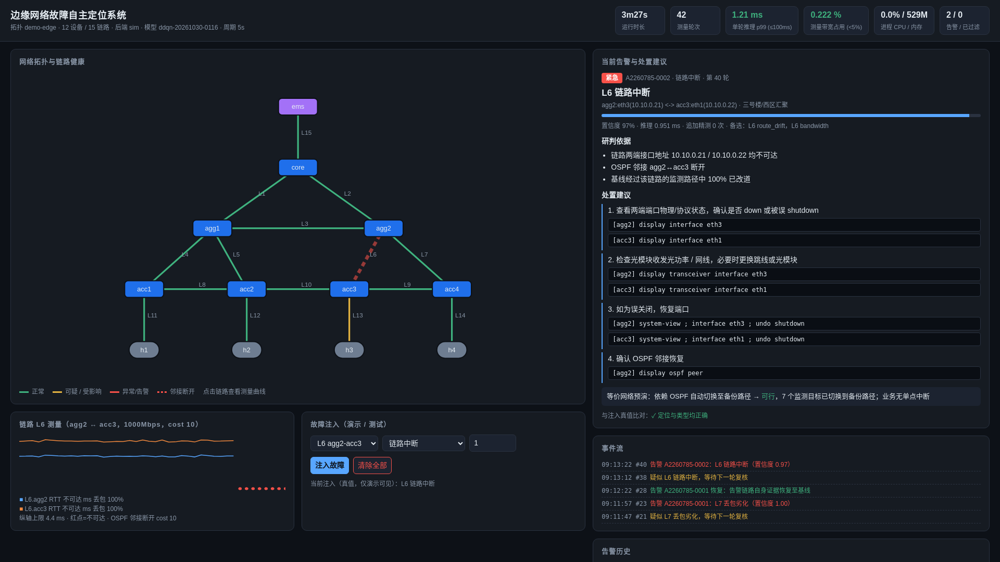
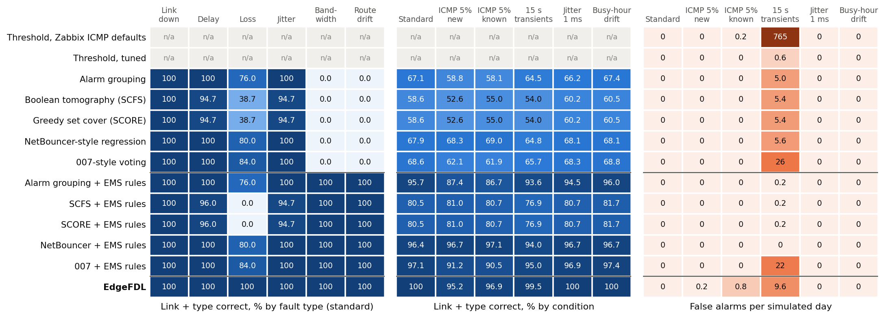

# EdgeFDL — Edge-network Fault Detection and Localization

**Names the faulty link and the fault type in an edge network from its management server: one alarm per fault,
read-only towards the devices.**

[](LICENSE)
[](https://github.com/seuclkzsd/EdgeFDL/actions/workflows/ci.yml)
[](https://github.com/seuclkzsd/EdgeFDL/releases)
[](pyproject.toml)

[Online demo (no install)](https://seuclkzsd.github.io/EdgeFDL/) · [Demo video (Chinese narration, 6 min 41 s)](https://github.com/seuclkzsd/EdgeFDL/releases/latest) · [Documentation](docs/index.md) · [Releases](https://github.com/seuclkzsd/EdgeFDL/releases) · [中文](README.zh-CN.md)


Campus, branch and factory networks (a core router, aggregation and access routers, hosts and one network-management
server, the EMS) rarely have dedicated network engineers: faults are reported by users and located by logging into
devices hop by hop, which takes hours. Per-target threshold monitoring does not say where the fault is. On the demo
topology, a degradation of the core–aggregation link L1 makes 16 of the 36 targets monitored from the EMS cross their
thresholds at once, and none of those alarms names the link; a degradation of the backup link L3 makes no target cross
a threshold at all. **EdgeFDL** runs on the EMS and is read-only towards the devices: pings and traceroutes start at
the EMS, and only bandwidth estimates and on-demand deep probes run between the two ends of a link. It measures the
network every 5 s with light probes; when an anomaly persists, a small DDQN agent names **the faulty link and the fault
type** (link down, delay, loss, jitter, bandwidth degradation, route drift) and raises **one alarm** with the evidence,
vendor-specific troubleshooting commands and remediation actions rehearsed on an equivalent virtual network. For L1 that
is a single alarm naming L1 and the fault type; for L3, coverage planning adds a device-native NQA / IP SLA probe to
the measurement plan (emulated on the virtual backends; reading it from real devices is planned for 0.3). The agent is trained for each network without
production fault data: faults are injected into an equivalent virtual network built from the network's own topology.

## Evidence at a glance

| Question | Answer | Evidence |
|---|---|---|
| Is it better than what exists? | In simulation only (12-device demo topology, 84 fixed fault scenarios × 5 seeds × 6 conditions, 2,520 runs): EdgeFDL names link and type in **98.6%**, first alarm after **38.9 s**, 53 false alarms in 30 simulated days, 48 of them under 15 s transients. NetBouncer-style regression with added LSDB and bandwidth rules, setting selected on separate validation seeds: 97.7%, 152.6 s, no false alarm; with λ = 0.01, which validation cannot separate from that setting: 99.2%, 154.5 s, 21 false alarms. Accuracy is close and depends on the baseline's settings; EdgeFDL's clear gains are time to alarm and concurrent faults: both of two simultaneous faults with types in **97.3%** against 93.3%, no wrong alarm (standard conditions, 300 cases). Baselines replay EdgeFDL's light measurements; EdgeFDL also uses deep probes (2.88 per fault over the six conditions, 1.05 under standard conditions), and without them gets 97.3%, 39.7 s, 197 false alarms. Per-target thresholds name no link and raise up to 36 alarms per fault | [Comparison](docs/comparison.md#measured-comparison) · [`compare.json`](results/compare.json) |
| Does it work outside a simulator? | On a real protocol stack (network namespaces, FRR OSPF, `tc`, wall-clock 5 s rounds) with the model trained on the simulator only: **84/84** single-fault scenarios alarmed with the right type and link, mean 37.9 s, all cleared after repair; device down 6/6; two faults: first alarm right 16/16, both reported 15/16; 0 false alarms in 2.67 network hours | [Results](docs/results.md#31-online-accuracy-on-the-real-protocol-stack) · [`realstack.json`](results/realstack.json) |
| Can it watch a real network? | `serve --backend live` measures a routed network from the EMS and never writes device configuration; with `--endpoints`, short-lived probe processes run on the machines you list. Black-box on a real protocol stack, with faults applied from outside the serving process and routers at the Linux default ICMP rate limit: **34/34** with LSDB access and link-end probes (device down not run in this mode), 30/36 with LSDB access, 28/36 from ping and traceroute alone. Not yet run on physical devices | [Connecting to a real network](docs/deployment.md#connecting-to-a-real-network) · [`live_blackbox.json`](results/live_blackbox.json) |
| Can I try it now? | Replay in the browser, `docker compose up`, or three commands from source; no hardware, no keys | [Quick start](#quick-start) |
| Is it safe to adopt? | Apache-2.0, read-only towards devices, every dependency listed with its license and checked in CI, hash-pinned image, quarterly roadmap with measurable criteria | [Dependencies](docs/dependencies.md) · [Roadmap](ROADMAP.md) · [Governance](GOVERNANCE.md) |

## Capabilities at a glance

| Capability | What it does | Evidence |
|---|---|---|
| Names the link and the fault type | Five fault types on any link (link down, delay, loss, jitter, bandwidth) and route drift on router–router links. Type + location accuracy on an independent test set of 10,000 samples: link down 100.00%, performance degradation (delay, loss, jitter, bandwidth) 98.73%, route drift 100.00% (targets ≥98% / ≥95% / ≥95%); false-alarm rate on normal samples 0.07%. Online: 84/84 single-fault scenarios (15 links × 5 types + route drift on 9 router–router links) alarmed with the right type and link, mean time to alarm 37.9 s | [Results](docs/results.md) · [`eval_test.json`](results/eval_test.json) · [`bench.json`](results/bench.json) |
| One alarm per fault | One alarm per faulty link, not one per affected target. A device that goes down becomes one device-level alarm covering all its links (60/60 trials). Two simultaneous link faults: first alarm correct in 100% of 300 trials, both reported in 97.67%, and after one is repaired its alarm clears while the other stays (100% of the trials in which both were active) | [Algorithms](docs/algorithms.md) · [`robust.json`](results/robust.json) |
| Robust under harsh conditions | 24 h simulated runs under 16 conditions (heavier and longer transients, missing measurements, ICMP rate limiting, background jitter, busy-hour drift): 0 false alarms per day in 12 of them, 1–2 in three, 9 when every transient lasts 15 s. Accuracy over the 84 scenarios stays between 96.4% and 100.0% under the 8 conditions tested | [Results](docs/results.md) · [`robust.json`](results/robust.json) |
| Lightweight | p99 0.575 ms per forward pass of the agent (PyTorch, 1 thread; NumPy engine 0.302 ms), 36,041 parameters; probe traffic 222.0 kbps = 0.222% of the narrowest 100 Mbps link even if all of it crossed that link; compute 0.0868% of one core; RSS 528.6 MB, mostly the PyTorch runtime (targets: ≤100 ms, <5%, ≤20%) | [`bench.json`](results/bench.json) |
| No production fault data needed | An equivalent virtual network enumerates the fault space (231 fault primitives on the demo topology). Samples are cut exactly when the online detector would wake the agent (trigger-aligned) and are domain-randomized (longer transients, ICMP rate limiting, background jitter). 60,000 samples in 87.8 s with 16 processes; training about 4.4 min on 8 CPU threads | [Architecture](docs/architecture.md) · [`pipeline.log`](results/pipeline.log) |
| Measured on a real protocol stack | The online engine with the released model on network namespaces + FRR OSPF + tc, in wall-clock 5 s rounds: 84/84 single-fault scenarios alarmed with the right type and link and cleared after repair, mean time to alarm 37.9 s; device down 6/6; two faults: first alarm right 16/16, both reported 15/16; 0 false alarms in 2.67 network hours, half of them with transients in 15% of rounds. Smoke test 26/26 checks in each of 3 runs; baseline RTT of each of the 37 targets within 0.74 ms of the simulator | [Results](docs/results.md#31-online-accuracy-on-the-real-protocol-stack) · [`realstack.json`](results/realstack.json) · [`results/smoke/`](results/smoke/) · [`sim_vs_stack.json`](results/sim_vs_stack.json) |
| Runs on a real network, read-only | `serve --backend live` measures the network from the EMS with ping and traceroute; it never writes device configuration, and injection is refused. Optional inputs: `--lsdb-cmd` runs a read-only command you supply, and `--endpoints` starts short-lived probe processes on the machines you list. `preflight` checks addresses, privileges and optional inputs first. Black-box on a real protocol stack: 34/34 scenarios right with `--lsdb-cmd` and `--endpoints` (mean time to alarm 38.7 s; device down not run in this mode), 30/36 with `--lsdb-cmd`, 28/36 from ping and traceroute alone with `--infer-state` (without packet trains, bandwidth faults are invisible); 0 alarms outside faults. Not yet run on physical devices | [Connecting to a real network](docs/deployment.md#connecting-to-a-real-network) · [`live_blackbox.json`](results/live_blackbox.json) |
| One command to run | `docker compose up` gives the dashboard on `http://127.0.0.1:8460` with the simulated network and the bundled model. Non-root container with a read-only root file system and no capabilities, CPU-only PyTorch, every Python package pinned by hash. Image 1023.6 MB, 171.2 MiB of memory after a fault-and-recovery cycle. Evaluating the bundled model inside the image reproduces `results/eval_test.json` byte for byte | [`docker_check.json`](results/docker_check.json) · [Deployment](docs/deployment.md#container-image) |
| Integrations | Web dashboard, REST API, Syslog (RFC 5424), Webhook (JSON), Prometheus `/metrics`, CSV logs with schema files | [API](docs/api.md) · [Deployment](docs/deployment.md) |

**Test conditions.** Accuracy, latency and robustness figures come from the analytic simulation backend on the
12-device demo topology ([`configs/demo_topology.yaml`](configs/demo_topology.yaml): core, two aggregation and four
access routers, four hosts and the EMS; 15 links of 1000 / 100 Mbps), with the released model
[`results/model.pt`](results/model.pt), on 2 × Intel Xeon Gold 6336Y (96 logical CPUs), Python 3.13, PyTorch 2.9.1 (CUDA 12.8 build, run on CPU).
The test set uses standard conditions and a seed different from training, and is scored end to end: a fault that never
triggers the detector counts as missed. Online runs use simulated time with 5 s rounds and a 15% chance per round of a
one-round delay spike or loss burst on a random link; the robustness suite uses seed 21. Raw outputs are in
[`results/`](results/README.md). Real-stack figures have their own conditions in
[section 3.1 of the results page](docs/results.md#31-online-accuracy-on-the-real-protocol-stack).

## Quick start

No network hardware needed: the bundled model runs against the simulated demo network.

**In the browser, no install.** The [recorded replay](https://seuclkzsd.github.io/EdgeFDL/) plays the real dashboard from
the API responses of one run on the simulator: a 20 ms delay on L1 puts 16 of the 36 targets over their thresholds and
raises one alarm naming L1, 35 s after the injection; link down with backup takeover, route drift, two simultaneous
faults and a device going down follow. How it is recorded: [docs/demo/README.md](docs/demo/README.md).

**One command, with Docker.**

```bash
git clone https://github.com/seuclkzsd/EdgeFDL.git && cd EdgeFDL
docker compose up        # builds the image on the first run; no Python needed
```

**From source.**

```bash
git clone https://github.com/seuclkzsd/EdgeFDL.git && cd EdgeFDL
python3 -m venv .venv && . .venv/bin/activate      # Python >= 3.8, Linux
pip install torch --index-url https://download.pytorch.org/whl/cpu && pip install -r requirements.txt
python -m edgefdl serve --model results/model.pt --backend sim --interval 2
```

Open <http://127.0.0.1:8460>. The topology is colored by link health. In the fault-injection panel (故障注入) pick a
link, a fault type and a value and press 注入故障 (inject). Once the anomaly has persisted and the diagnosis is confirmed,
the alarm panel shows the faulty link, both interfaces, the evidence, the vendor commands and the result of the
rehearsal on the equivalent network; 清除全部 (clear all) repairs the fault and the alarm clears. `--interval 2`
shortens the measurement period from 5 s to 2 s for the demo. Training a model for your own network, running it on
that network's equivalent virtual network and connecting alarm sinks is described in
[docs/deployment.md](docs/deployment.md).



*Dashboard during the demo: link L6 is down. The alarm names the link and both interfaces, lists the evidence, gives
vendor commands and reports that the rehearsed OSPF takeover to the backup path is feasible. The UI is in Chinese.*

## Reproduce the results

| What | Command | Notes |
|---|---|---|
| Comparison with the methods behind existing tools | `python -m edgefdl compare --model results/model.pt --out runs/compare --workers 24` | about 18 min with 24 workers |
| Full pipeline: baseline → 60,000 samples → training → evaluation → self-test | `python -m edgefdl pipeline --out runs/v6 --workers 16` | about 15 min on CPU |
| Accuracy on the test set | `python -m edgefdl eval --model results/model.pt --data runs/v6/test.npz` | `test.npz` is written by the pipeline |
| Self-test | `python -m edgefdl bench --model results/model.pt --out runs/bench --rounds 51840` | 51,840 rounds × 5 s = 72 h of simulated time |
| Robustness suite | `python -m edgefdl robust --model results/model.pt --out runs/robust --workers 40` | about 3.5 min with 40 workers |
| Real protocol stack | `scripts/lab.sh build && scripts/lab.sh smoke` | Docker with privileged containers; 26 checks |
| Accuracy on the real protocol stack | see [docs/results.md, section 3.1](docs/results.md#31-online-accuracy-on-the-real-protocol-stack) | Docker with privileged containers; about 1.5 h with 12 containers |
| `live` backend, black box | `scripts/lab.sh build-torch`, then `EDGEFDL_LAB_IMAGE=edgefdl-lab-torch:latest scripts/lab.sh run python3 scripts/live_blackbox.py --mode lsdb` | Docker with privileged containers; about 30 min per 17 scenarios |
| Container image end to end | `tools/dev/ci.sh image` | Docker with the compose plugin; builds, injects a fault through the REST API, checks alarm and recovery, removes everything |
| Dashboard replay | `python tools/demo/record.py` | one real-time run, about 14 min |
| Unit tests | `python -m unittest discover -s tests` | 220 tests |

The pipeline trains a new model in `runs/v6/`, which is not identical to the released one; the figures on this page
were measured with `results/model.pt`, and evaluating that bundle reproduces the test-set figures exactly. The lab
image installs FRR, iperf3, traceroute and iproute2 on Debian 12; set `EDGEFDL_APT_MIRROR` to use a local Debian mirror.
`python -m edgefdl.vnet.lxd configs/demo_topology.yaml --uplink ems=enp3s0` prints the LXD deployment commands (dry run).

## How it works

- **Offline, once per network:** requirements intake (form, device configurations, LLDP) → topology model → equivalent
  virtual network (`sim` analytic simulator, `netns` namespaces + FRR + tc, or `lxd` containers, with the same fault
  semantics) → normal baseline → fault space (link × type × value) → trigger-aligned, domain-randomized samples → DDQN
  training → evaluation → one model bundle (`model.pt`: weights, topology, baseline, measurement plan).
- **Online, on the EMS:** every 5 s ping to every interface, loopback and host, traceroute paths, packet-train bandwidth
  estimates and the OSPF LSDB → k-of-n anomaly detector → the agent diagnoses in at most 4 steps and may request a deep
  probe of a single link → confirmation → alarm, device-down aggregation, per-alarm recovery; concurrent faults are
  separated by re-baselining on the residual.
- **The agent** sees the network as links: per-link tomography features from a single vantage point (end-interface RTT
  differences, routing-matrix contrast, path changes, LSDB, bandwidth), a link-shared encoder whose size does not depend
  on the topology, Double + Dueling DQN, prioritized replay, action masking, and a reward that charges for each deep
  probe, so it probes only when the evidence is insufficient (0.061 deep probes per test sample on average).

Details: [architecture](docs/architecture.md) · [algorithms](docs/algorithms.md).

## Compared with existing open-source tools

**Measured on the same light measurements, in simulation.** `python -m edgefdl compare` replays the light measurements
the engine sees through re-implementations of threshold alerting, alarm grouping, boolean tomography, greedy set cover,
NetBouncer-style regression and 007-style voting, each with the routing matrix, pings to both interfaces of every link,
and default and tuned parameters. These are the published methods, not the products. EdgeFDL may also use deep probes,
which the baselines do not replay. On the 84 single-fault scenarios under standard conditions (5 seeds) EdgeFDL names
link and type in 100.0% with one alarm per fault, no false alarm and 38.5 s to alarm, and also 100.0% without deep
probes. With added LSDB and bandwidth rules and settings selected by validation F1, baselines reach 99.5% in 154.1 s,
96.9% in 88.6 s and 95.7% in 73.8 s, with no false alarm on these streams; regression with λ = 0.01, which validation
cannot separate, also reaches 100.0%, in 154.6 s. At default settings grouping reaches 98.3% in 34.5 s at 52.2 false
alarms per day.



EdgeFDL is behind under ICMP rate limiting (95.2% and 96.9% against 97.6%), on false alarms when every transient lasts
15 s (9.6 per day against 0.0), and on time to alarm for link down, route drift and bandwidth, where a short rule on the
LSDB or the bandwidth estimate takes 10 s, 10 s and 40 s against 30 s, 30 s and 60 s (standard conditions). Full tables, parameters and what
this does not cover: [docs/comparison.md](docs/comparison.md#measured-comparison).

**Capabilities**, from public documentation. The tools are mature and much broader in scope; EdgeFDL complements them
and sends its alarms to them via Syslog, Webhook or Prometheus.

| | General monitoring<br>Zabbix · Prometheus · Nightingale | Network management<br>LibreNMS · OpenNMS ALEC | Active measurement<br>perfSONAR · SmokePing | **EdgeFDL** |
|---|---|---|---|---|
| Alarm object | monitored item or target | device events, grouped by time and topology | measured path | **faulty link and its two interfaces** |
| Link delay / loss / jitter / bandwidth | per-target thresholds; link found by hand | interface down detected directly; no link-level performance inference | path-level measurements; link found by comparing paths | **identified and located automatically** |
| Route drift | needs custom items | OSPF neighbours visible; cost drift not judged | traceroute, read by hand | **LSDB cost + path change** |
| Deployment | agents or SNMP | SNMP, syslog | measurement hosts at path ends (perfSONAR) | **one EMS, read-only; link-end probe endpoints only for bandwidth and deep probes** |
| Where the rules come from | manual thresholds and dependencies | manual rules, clustering of past alarms | manually configured tests | **samples from the equivalent virtual network** |

More, including research approaches (network tomography, NetBouncer, 007): [docs/comparison.md](docs/comparison.md).

## Repository layout

```
edgefdl/            the Python package (python -m edgefdl ...)
  topology.py         topology model, IP plan, OSPF SPF, monitored targets, coverage planning
  intake/             requirements form, device configuration and LLDP extraction
  vnet/               equivalent virtual network: sim, netns (+ FRR), lxd backends; live backend for a real network
  faults/             fault model, injector (tc / netem / tbf / ip / vtysh), sample generator
  measure/            probes and parsers, CSV store with schema files
  agent/              features, DDQN, inference (PyTorch and NumPy engines), advice and rehearsal
  core/               detector, orchestrator, alarm sinks, HTTP API, web dashboard
  bench.py robust.py compare.py  self-test, robustness and comparison harnesses
configs/            demo topology and a sample intake form with device configurations
results/            released model, result JSON files, pipeline log, real-stack smoke logs
scripts/            lab container (lab.sh, Dockerfile), real-stack smoke test and accuracy run, live backend black-box
                    test, simulator vs real-stack RTT comparison, multi- vs single-alarm comparison
tests/              unit tests
tools/              SPDX and license checks, lock file generator, CI script, figure generation, replay recorder
docs/               documentation, images, dashboard screenshots, recorded replay (docs/demo/)
Dockerfile compose.yaml requirements-lock.txt   one-command run from a hash-pinned image
```

## Documentation

Start at [docs/index.md](docs/index.md): [quick start](docs/quickstart.md), [deployment](docs/deployment.md),
[REST API and integrations](docs/api.md), [architecture](docs/architecture.md), [algorithms](docs/algorithms.md),
[results](docs/results.md), [comparison](docs/comparison.md), [result files](results/README.md).

## Contributing

Code, documentation, topologies and **field reports from real edge networks** are welcome: a report of how EdgeFDL
behaved on your network, including where it was wrong, is the most valuable contribution and needs no programming. See
[CONTRIBUTING.md](CONTRIBUTING.md), the [code of conduct](CODE_OF_CONDUCT.md) and the issue templates.

## Governance and security

EdgeFDL is maintained by [@seuclkzsd](https://github.com/seuclkzsd); roles and decision rules are in
[GOVERNANCE.md](GOVERNANCE.md) and [MAINTAINERS.md](MAINTAINERS.md). Report vulnerabilities privately as described in
[SECURITY.md](SECURITY.md). Questions and help: [SUPPORT.md](SUPPORT.md). Version history: [CHANGELOG.md](CHANGELOG.md).

## License

EdgeFDL is released under the [Apache License 2.0](LICENSE); see [NOTICE](NOTICE) for attributions and third-party
components. Every runtime dependency with its version and license, the external programs and the distribution boundary
are listed in [docs/dependencies.md](docs/dependencies.md).

## Citation

Please cite EdgeFDL as described in [CITATION.cff](CITATION.cff) ("Cite this repository" on GitHub):

```bibtex
@software{edgefdl,
  author  = {seuclkzsd},
  title   = {EdgeFDL: Edge-network Fault Detection and Localization},
  year    = {2026},
  version = {0.2.0},
  url     = {https://github.com/seuclkzsd/EdgeFDL},
  license = {Apache-2.0}
}
```

## Limitations and next steps

- `serve --backend live` measures a real routed network read-only from the EMS; it is validated black-box on the
  `netns` real stack on 6 of the 15 demo links and has not yet run on physical devices. For the LXD backend the
  generated commands are verified (dry run) but have not yet been run on hardware.
- Accuracy and robustness figures come from the analytic simulation backend on the 12-device demo topology, except the
  real-stack run: 84 scenarios, device-down and two-fault cases on netns + FRR + tc, with emulated links, one fault size
  per type and no background traffic. The harsh conditions of the robustness suite have not been repeated on the stack.
- The harsh conditions (ICMP rate limiting, busy-hour drift, long transients) are modelled by us, not measured on
  production networks. The 72 h figure is simulated time; a 72-hour real-time run is planned.
- Light probes (5 packets per target per round) do not detect one-way loss below about 3%, or a bandwidth reduction
  that leaves more than about 70% of the baseline. With routers dropping 5% of ICMP replies, some 15% loss faults
  in the online scenarios were missed on L8 and L10, each crossed by a single monitored path, or attributed to a
  neighbouring link (L2 reported as L7). Faults behind the management uplink (L15) cannot be told apart from an
  uplink fault.
- Heavy loss (≥30%) makes real OSPF adjacencies flap, which the simulator does not model yet.
- One model per topology, by design; transfer of the shared encoder across topologies is not yet validated.
- Code comments, CLI help and the dashboard are in Chinese; the documentation is in English.

Next: the `live` backend on physical routers, the LXD backend on hardware, a 72-hour real-time run, real-stack samples
(including heavy loss), SNMP / NQA readers, Kylin OS and openEuler, a PyPI package and an English UI. Quarterly plan, success criteria
and non-goals: [ROADMAP.md](ROADMAP.md).
