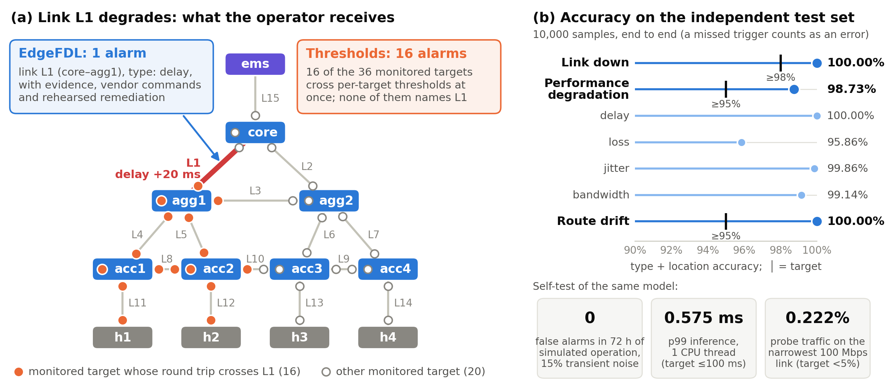

# EdgeFDL：边缘网络故障自主定位系统

**在网管服务器上指出故障链路与故障类型，一个故障一条告警，对设备只读。**

[](LICENSE)
[](https://github.com/seuclkzsd/EdgeFDL/actions/workflows/ci.yml)
[](https://github.com/seuclkzsd/EdgeFDL/releases)
[](pyproject.toml)

[文档（英文）](docs/index.md) · [演示视频（中文配音，6 分 41 秒）](https://github.com/seuclkzsd/EdgeFDL/releases/latest) · [版本发布](https://github.com/seuclkzsd/EdgeFDL/releases) · [English](README.md)

> 本文是 [README.md](README.md) 的中文译本，**以英文版为准**。其余文档以英文撰写。



园区、分支机构和工厂的边缘网络（一台核心路由器、汇聚与接入路由器、业务主机和一台网管服务器 EMS）通常没有专职网络工程师：
故障靠用户报障发现，再逐跳登录设备排查，往往要几个小时。按目标设阈值的监控并不能告诉你故障在哪里。在演示拓扑上，
核心—汇聚链路 L1 劣化时，从网管侧监测的 36 个目标中有 16 个同时越过阈值，而这些告警没有一条指出是哪条链路；
备份链路 L3 劣化时，没有任何目标越过阈值。**EdgeFDL** 运行在网管服务器上，对设备只读：ping 与 traceroute 都从网管服务器
发起，只有带宽估计和按需精测在链路两端之间进行。它每 5 秒用轻量探测测量一次网络；异常持续出现时，一个小型 DDQN
智能体指出**故障链路与故障类型**（链路中断、时延、丢包、抖动、带宽劣化、路由漂移），并给出**一条告警**，附研判依据、
分厂商的排查命令，以及在等价虚拟网络上预演过的处置措施。对 L1，就是一条指明 L1 与故障类型的告警；对 L3，覆盖规划会补上
一个设备侧的 NQA / IP SLA 探测，由运维在设备上配置一次，EdgeFDL 只读取其结果。智能体按每个网络单独训练，不需要生产网络的故障数据：故障注入在依据该网络自身拓扑构建的等价虚拟网络中进行。

## 能力一览

| 能力 | 做什么 | 证据 |
|---|---|---|
| 指出链路与故障类型 | 任意链路上的五类故障（链路中断、时延、丢包、抖动、带宽），以及路由器间链路上的路由漂移。独立测试集（10,000 个样本）上的类型+定位准确率：链路中断 100.00%，性能劣化（时延、丢包、抖动、带宽）98.73%，路由漂移 100.00%（设计指标 ≥98% / ≥95% / ≥95%）；正常样本误报率 0.07%。在线运行：84/84 个单故障场景（15 条链路 × 5 类 + 9 条路由器间链路的路由漂移）均以正确的类型与链路告警，平均发现时间 37.9 s | [结果](docs/results.md) · [`eval_test.json`](results/eval_test.json) · [`bench.json`](results/bench.json) |
| 一个故障一条告警 | 每条故障链路一条告警，而不是每个受影响目标一条。设备整机宕机聚合为一条覆盖其全部链路的设备级告警（60/60 次试验）。两条链路同时故障：300 次试验中首条告警 100% 正确，两处均报出 97.67%；修复其中一处后，该告警恢复而另一条保持（两条均处于活动状态的试验中 100%） | [算法](docs/algorithms.md) · [`robust.json`](results/robust.json) |
| 恶劣条件下稳定 | 16 种条件（更强、更长的瞬时干扰，测量缺失，ICMP 限速，背景抖动，忙时时延抬升）各做 24 小时仿真长跑：其中 12 种每天 0 条无效告警，3 种每天 1–2 条，每次干扰持续 15 s 时每天 9 条。在测试的 8 种条件下，84 个场景的准确率保持在 96.4%–100.0% | [结果](docs/results.md) · [`robust.json`](results/robust.json) |
| 轻量 | 智能体单次前向推理 p99 0.575 ms（PyTorch，单线程；NumPy 引擎 0.302 ms），参数量 36,041；探测流量 222.0 kbps，即使全部经过最窄的 100 Mbps 链路也只占 0.222%；计算占单核 0.0868%；常驻内存 528.6 MB，主要是 PyTorch 运行时（设计指标：≤100 ms、<5%、≤20%） | [`bench.json`](results/bench.json) |
| 不需要生产故障数据 | 等价虚拟网络枚举故障空间（演示拓扑上 231 个故障原语）。样本恰好在在线判决器会唤醒智能体的时刻截取（触发对齐），并做域随机化（更长的瞬时干扰、ICMP 限速、背景抖动）。16 个进程 87.8 s 生成 60,000 个样本；8 个 CPU 线程训练约 4.4 分钟 | [架构](docs/architecture.md) · [`pipeline.log`](results/pipeline.log) |
| 真实协议栈验证 | 特权容器内的网络命名空间 + FRR OSPF + tc，26 项检查，连续 3 次均 26/26 通过：链路中断 → 两端接口不可达且流量绕行；单向时延 +20 ms → RTT +40.0 ms；带宽降至 20% → 精测 200 Mbps；OSPF 开销 ×10 → 路径绕开该链路，LSDB 开销 100；37 个监测目标的基线 RTT 与仿真后端相差均不超过 0.74 ms（中位数 0.39 ms）；每轮探测流量约 290 KB（≈465 kbps，每目标 10 个 ping，默认为 5 个） | [`results/smoke/`](results/smoke/) · [`sim_vs_stack.json`](results/sim_vs_stack.json) |
| 系统集成 | Web 大屏、REST API、Syslog（RFC 5424）、Webhook（JSON）、Prometheus `/metrics`、带 schema 文件的 CSV 日志 | [API](docs/api.md) · [部署](docs/deployment.md) |

**测试条件。** 准确率、时延与鲁棒性数据均来自解析仿真后端与 12 设备演示拓扑
（[`configs/demo_topology.yaml`](configs/demo_topology.yaml)：核心、两台汇聚和四台接入路由器、四台主机与网管服务器；
15 条 1000 / 100 Mbps 链路），使用发布的模型 [`results/model.pt`](results/model.pt)，硬件为 2 × Intel Xeon Gold 6336Y
（96 个逻辑 CPU），Python 3.13，PyTorch 2.9.1（CUDA 12.8 版本，在 CPU 上运行）。测试集为标准条件、随机种子与训练不同，按端到端口径统计：判决器从未
触发的故障记为漏报。在线运行使用仿真时间，每轮 5 s，每轮有 15% 的概率在随机一条链路上出现单轮时延尖峰或突发丢包；
鲁棒性测试的随机种子为 21。原始输出见 [`results/`](results/README.md)。

## 快速开始

不需要网络设备：发布的模型直接在仿真的演示网络上运行。

```bash
git clone https://github.com/seuclkzsd/EdgeFDL.git && cd EdgeFDL
pip install -r requirements.txt          # numpy、pyyaml、torch（CPU 版即可）；Python >= 3.8，Linux
python -m edgefdl serve --model results/model.pt --backend sim --interval 2
```

浏览器打开 <http://127.0.0.1:8460>。拓扑按链路健康状态着色。在"故障注入"面板选择链路、故障类型和取值，点击"注入故障"。
异常持续出现、研判得到确认后，告警面板会显示故障链路、两端接口、研判依据、厂商命令以及在等价网络上的预演结果；点击
"清除全部"即修复故障，告警随之恢复。`--interval 2` 把测量周期从 5 s 缩短到 2 s，便于演示。为自己的网络训练模型、
在该网络的等价虚拟网络上运行并接入告警外发，见 [docs/deployment.md](docs/deployment.md)。


*演示中的运维大屏：链路 L6 中断。告警指明链路与两端接口，列出研判依据和厂商命令，并给出预演结论：OSPF 切换到备份路径可行。*

## 复现结果

| 内容 | 命令 | 说明 |
|---|---|---|
| 完整流水线：基线 → 60,000 个样本 → 训练 → 评估 → 自测 | `python -m edgefdl pipeline --out runs/v6 --workers 16` | CPU 约 15 分钟 |
| 测试集准确率 | `python -m edgefdl eval --model results/model.pt --data runs/v6/test.npz` | `test.npz` 由流水线生成 |
| 指标自测 | `python -m edgefdl bench --model results/model.pt --out runs/bench --rounds 51840` | 51,840 轮 × 5 s = 72 小时仿真时间 |
| 鲁棒性测试 | `python -m edgefdl robust --model results/model.pt --out runs/robust --workers 40` | 40 个工作进程约 3.5 分钟 |
| 真实协议栈 | `scripts/lab.sh build && scripts/lab.sh smoke` | 需要 Docker 与特权容器；26 项检查 |
| 单元测试 | `python -m unittest discover -s tests` | 72 个测试 |

流水线会在 `runs/v6/` 训练一个新模型，它与发布的模型并不相同；本页的数据都是用 `results/model.pt` 测得的，评估这个模型包可原样复现测试集结果。实验容器镜像基于 Debian 12，安装
FRR、iperf3、traceroute 和 iproute2；设置 `EDGEFDL_APT_MIRROR` 可使用本地 Debian 镜像源。
`python -m edgefdl.vnet.lxd configs/demo_topology.yaml --uplink ems=enp3s0` 打印 LXD 部署命令序列（不执行）。

## 工作原理

- **离线，每个网络一次：** 需求采集（采集表、设备配置、LLDP）→ 拓扑模型 → 等价虚拟网络（`sim` 解析仿真、`netns` 命名空间
  + FRR + tc、`lxd` 容器，三者故障语义相同）→ 正常基线 → 故障空间（链路 × 类型 × 取值）→ 触发对齐、域随机化的样本 →
  DDQN 训练 → 评估 → 单文件模型包（`model.pt`：权重、拓扑、基线、测量计划）。
- **在线，在网管服务器上：** 每 5 s 对所有接口、环回和主机做 ping，traceroute 逐跳路径，包列法带宽估计，读取 OSPF LSDB
  → k-of-n 异常判决 → 智能体最多 4 步研判，可请求对单条链路精测 → 确认 → 告警、设备宕机聚合、逐条恢复；多处同时故障
  通过残差再基线分别识别。
- **智能体**以链路为单位看网络：单一观测点的逐链路层析特征（链路两端接口的 RTT 差、路由矩阵对比、路径变化、LSDB、带宽），
  参数量与拓扑规模无关的链路共享编码器，Double + Dueling DQN，优先经验回放，动作掩码，以及对每次精测计费的奖励——
  因此只有证据不足时才精测（测试集上平均每个样本 0.061 次精测）。

详见：[架构](docs/architecture.md) · [算法](docs/algorithms.md)。

## 与现有开源工具对比

能力层面的对比，依据各项目的公开文档；我们没有实际运行这些工具。它们成熟且覆盖面广得多；EdgeFDL 是对它们的补充，告警可经
Syslog、Webhook 或 Prometheus 送入这些平台。

| | 通用监控告警<br>Zabbix · Prometheus · 夜莺 | 网管与告警关联<br>LibreNMS · OpenNMS ALEC | 主动性能测量<br>perfSONAR · SmokePing | **EdgeFDL** |
|---|---|---|---|---|
| 告警对象 | 监测项或目标 | 设备事件，按时间与拓扑归并 | 测量路径 | **故障链路及其两端接口** |
| 链路时延 / 丢包 / 抖动 / 带宽 | 按目标设阈值；链路靠人工推断 | 可直接发现接口 down；不做链路级性能推断 | 路径级测量；靠人工比对路径定位链路 | **自动识别并定位** |
| 路由漂移 | 需自定义监测项 | 可看 OSPF 邻居；不判别开销漂移 | traceroute，人工研判 | **LSDB 开销 + 路径变化** |
| 部署 | 代理或 SNMP | SNMP、Syslog | 路径两端的测量节点（perfSONAR） | **一台网管服务器，对设备只读；仅带宽估计与精测使用链路两端的探测端点** |
| 规则从哪来 | 人工阈值与依赖关系 | 人工规则、历史告警聚类 | 人工配置测量任务 | **等价虚拟网络生成的样本** |

更多内容（包括网络层析、NetBouncer、007 等研究方法）：[docs/comparison.md](docs/comparison.md)。

## 目录结构

```
edgefdl/            Python 包（python -m edgefdl ...）
  topology.py         拓扑模型、IP 规划、OSPF 最短路、监测目标、覆盖规划
  intake/             需求采集表、设备配置与 LLDP 提取
  vnet/               等价虚拟网络：sim、netns（+ FRR）、lxd 后端
  faults/             故障模型、注入器（tc / netem / tbf / ip / vtysh）、样本生成
  measure/            探测与解析、带 schema 文件的 CSV 存储
  agent/              特征、DDQN、推理（PyTorch 与 NumPy 引擎）、处置建议与预演
  core/               判决器、总控、告警外发、HTTP API、Web 大屏
  bench.py robust.py  指标自测与鲁棒性测试
configs/            演示拓扑，以及带设备配置的采集表示例
results/            发布的模型、结果 JSON、流水线日志、真实协议栈冒烟日志
scripts/            实验容器（lab.sh、Dockerfile）、真实协议栈冒烟测试、仿真与真实协议栈 RTT 对比、
                    多告警与单告警对照
tests/              单元测试
tools/              SPDX 许可头检查、CI 脚本、插图生成
docs/               文档、插图与运维大屏截图
```

## 文档

从 [docs/index.md](docs/index.md) 开始（英文）：[快速开始](docs/quickstart.md)、[部署](docs/deployment.md)、
[REST API 与集成](docs/api.md)、[架构](docs/architecture.md)、[算法](docs/algorithms.md)、[结果](docs/results.md)、
[对比](docs/comparison.md)、[结果文件说明](results/README.md)。

## 参与贡献

欢迎贡献代码、文档、拓扑，尤其欢迎**来自真实边缘网络的现场报告**：EdgeFDL 在你的网络上表现如何、哪里判断错了，这是最有价值
的贡献，而且不需要写代码。见 [CONTRIBUTING.md](CONTRIBUTING.md)、[行为准则](CODE_OF_CONDUCT.md) 和 Issue 模板。

## 治理与安全

EdgeFDL 由 [@seuclkzsd](https://github.com/seuclkzsd) 维护；角色与决策规则见 [GOVERNANCE.md](GOVERNANCE.md) 和
[MAINTAINERS.md](MAINTAINERS.md)。安全漏洞请按 [SECURITY.md](SECURITY.md) 私下报告。版本历史：[CHANGELOG.md](CHANGELOG.md)。

## 许可证

EdgeFDL 以 [Apache License 2.0](LICENSE) 发布；署名与第三方组件见 [NOTICE](NOTICE)。

## 引用

请按 [CITATION.cff](CITATION.cff) 引用 EdgeFDL（GitHub 页面上的 "Cite this repository"）：

```bibtex
@software{edgefdl,
  author  = {seuclkzsd},
  title   = {EdgeFDL: Edge-network Fault Detection and Localization},
  year    = {2026},
  version = {0.1.2},
  url     = {https://github.com/seuclkzsd/EdgeFDL},
  license = {Apache-2.0}
}
```

## 局限与后续工作

- 在 v0.1.2 中，`serve` 测量的是等价虚拟网络（`sim`、`netns` 或 `lxd` 后端）；接入物理网络是路线图的第一项。
  准确率与鲁棒性数据来自解析仿真后端与 12 设备演示拓扑。真实协议栈（netns + FRR + tc）通过冒烟测试验证，尚未做准确率
  测试；LXD 后端已验证生成的命令（不执行），尚未在硬件上运行。
- 恶劣条件（ICMP 限速、忙时时延抬升、长时干扰）由我们建模，不是在生产网络上实测的。72 小时数据是仿真时间；72 小时实时
  长跑已列入计划。
- 轻量探测（每轮每目标 5 个包）检测不到低于约 3% 的单向丢包，也检测不到剩余带宽仍在基线约 70% 以上的劣化。路由器丢弃 5% 的 ICMP 应答时，
  在线场景中部分 15% 丢包故障在只有一条监测路径经过的 L8、L10 上漏报，或被归到相邻链路（L2 报为 L7）。
  网管上联（L15）之后的故障无法与上联本身的故障区分。
- 重度丢包（≥30%）会使真实 OSPF 邻接震荡，仿真器暂未建模。
- 按设计每个拓扑一个模型；共享编码器的跨拓扑迁移尚未验证。
- 代码注释、命令行帮助和运维大屏为中文；文档为英文。

后续：LXD 后端在硬件上与物理网络互通、72 小时实时长跑、真实协议栈样本（含重度丢包）、SNMP / NQA 读取、麒麟 OS 与
openEuler 适配、PyPI 包、英文界面。按季度的计划、衡量标准与不做的事项见 [ROADMAP.md](ROADMAP.md)。
