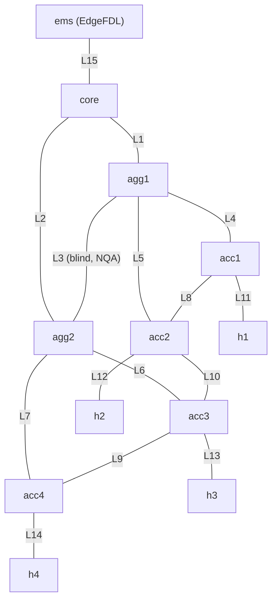
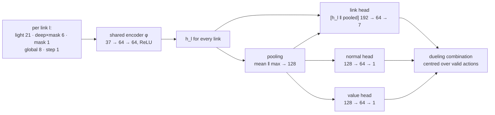

# Algorithms

This page specifies the methods EdgeFDL uses, with the parameter values of release 0.1.0. Every value below is
the default in the code; the file that holds it is named in each section. The component layout and data flow are
in [architecture.md](architecture.md); measured accuracy, latency and robustness are in [results.md](results.md).

1. [Notation and the demo topology](#1-notation-and-the-demo-topology)
2. [Measurement](#2-measurement)
3. [Normal baseline](#3-normal-baseline)
4. [Per-round anomaly test](#4-per-round-anomaly-test)
5. [k-of-n detector](#5-k-of-n-detector)
6. [Link-level tomography features](#6-link-level-tomography-features)
7. [The DDQN agent](#7-the-ddqn-agent)
8. [Training data](#8-training-data)
9. [Online decision logic](#9-online-decision-logic)
10. [Adaptive baseline](#10-adaptive-baseline)
11. [Device-down aggregation](#11-device-down-aggregation)
12. [Concurrent alarms by residual re-baselining](#12-concurrent-alarms-by-residual-re-baselining)
13. [Remediation advice and rehearsal](#13-remediation-advice-and-rehearsal)
14. [Limits of the methods](#14-limits-of-the-methods)
15. [References](#references)

## 1. Notation and the demo topology

The network has devices (routers, switches, hosts and the EMS) and $L$ links. Every link has a bandwidth, a
one-way delay, a background jitter, an OSPF cost and the addresses of its two interfaces
([`topology.py`](../edgefdl/topology.py)).

**Routing model.** Routes are OSPF shortest paths computed by Dijkstra on the interface costs, with ties broken by
device name so the result is deterministic; hosts and the EMS originate traffic but do not forward it. An
interface address follows real device behaviour: a probe first reaches the end of the link that is closer to the
source and, if that end does not own the address, crosses the link over the connected route; when the link is
down its subnet is withdrawn and both interface addresses become unreachable. The reply returns along the
owner's own shortest path.

**Targets.** The EMS probes $T$ targets: every link-end interface address except its own, every router loopback,
and one NQA target per blind link (Section 2.5). Two matrices describe how targets see links:

- $U \in \lbrace 0,1 \rbrace^{L \times T}$: $U_{lt} = 1$ if link $l$ lies on the baseline forward path to target $t$
  (from traceroute).
- $A \in \mathbb{N}^{T \times L}$: the number of times one round trip to $t$ crosses $l$, forward and return,
  computed from the topology and the current OSPF state. $A^0$ is its baseline value.

**Demo topology** ([`configs/demo_topology.yaml`](../configs/demo_topology.yaml)): 12 devices and 15 links.
L5, L7, L8, L9 and L10 run at 100 Mbit/s, the others at 1 Gbit/s. It has 36 EMS-side targets plus one NQA target.



## 2. Measurement

### 2.1 Measurement plan

The plan is the `MeasurePlan` dataclass in [`measure/model.py`](../edgefdl/measure/model.py). It is stored in the
model bundle, so sample generation and online operation use the same plan.

| Item | Default | Notes |
|---|---|---|
| Period | 5 s | one round measures every target once |
| Connectivity and delay | 5 pings per target, 0.2 s apart, 56 B payload | per round: sent, received, mean RTT, RTT deviation (mdev) |
| Hop-by-hop path | traceroute to every EMS-sourced target every round | ICMP, one query per hop; retried once if a hop is missing; still incomplete means "path unknown", never "path changed" |
| Light bandwidth estimate | packet train on 3 links per round, round robin; 16 packets × 1400 B | each link is estimated about every $L/3$ rounds (every 5 rounds on the demo topology) |
| Control plane | OSPF link-state database every round | adjacency state and cost of every link |
| Diagnosis window | last 6 rounds | features use window medians and persistence |
| Deep probe (on demand) | 100 pings at 10 ms between the two link ends, plus 1 s of iperf3 at no more than 30 % of the link bandwidth | issued only by the agent and by alarm rechecks |

Pings and traceroutes start at the EMS. NQA targets are probed by the link's endpoint device. Packet trains and
deep probes run between the two ends of the link; in the virtual backends they run inside the endpoint
namespaces or containers, on a physical network they need a probe endpoint at the link ends (the topology's `agent`
flag marks the devices that can host one, and the `netns` and `lxd` backends leave links with no such end out of the
light bandwidth polling). In the virtual backends the LSDB is read with FRR `show ip ospf database router json` on the EMS's gateway router: a
router–router link is up when both router-LSAs list the point-to-point link, a router–host link when its stub
network is advertised ([`vnet/stack.py`](../edgefdl/vnet/stack.py)).

### 2.2 Packet-train bandwidth estimate

The sender transmits $n_r$ back-to-back UDP packets of $s_r$ bytes; the receiver records kernel timestamps
(`SO_TIMESTAMPNS`). The bottleneck spreads the train out, and its dispersion gives the capacity
[Dovrolis et al. 2004]. With the $m$ arrival times sorted, the first two dropped when at least 8 arrived
(token-bucket shapers let the first packets through at line rate) and $k = \max(2, \lfloor m/4 \rfloor)$:

```math
w_i = \frac{t_{i+k} - t_i}{k}, \qquad \hat C = \frac{8\,(s_r + 42)}{\operatorname{median}_i w_i}
```

where 42 B are the Ethernet, IP and UDP headers. The estimate is reliable when
$\operatorname{median}_i w_i \le 1.3 \min_i w_i$; otherwise per-packet jitter has scrambled the dispersion and the
light estimate is discarded ([`measure/probes.py`](../edgefdl/measure/probes.py)). On the real stack the train is
lengthened so that it occupies at least 0.5 ms of the bottleneck (47 packets of 1400 B on a 1 Gbit/s link) and the
estimate is capped at 1.05 times the nominal rate. The simulator returns the effective capacity with a
multiplicative log-normal error ($\sigma = 0.08$), capped the same way.

### 2.3 Deep probe

A deep probe measures one link from one end to the other: 100 pings at 10 ms (RTT, deviation and loss of that link
alone), three 64-packet trains whose median reliable estimate is the capacity, and a 1 s UDP iperf3 run at 30 % of
the nominal bandwidth. Capacity comes from the trains rather than from the iperf3 throughput because throughput
also falls under loss and jitter and would look like a bandwidth fault; the throughput is kept for the alarm
details. The two are cross-checked: when iperf3 reaches at least 85 % of the requested rate, the capacity cannot be
below the measured throughput, so a lower train estimate (packet timing scrambled by jitter far larger than the
per-packet service time) is discarded and the nominal bandwidth is used; when every train is unreliable and iperf3
falls short of the requested rate, the throughput is the capacity.

### 2.4 Traffic budget

`MeasurePlan.light_bytes_per_round` budgets the light measurement as

```math
B = \frac{2 N_t n_p (s_p + 42) + 2 \cdot 3 \cdot 60 \cdot N_t \bar h + m\, n_r s_r}{T}
```

with $N_t$ targets, $n_p$ pings of $s_p$ bytes payload (plus 28 B ICMP/IP and 14 B Ethernet headers, both
directions), traceroute budgeted at 3 probes of 60 B per hop over $\bar h$ hops on average (the real stack sends
one per hop), $m$ trains of $n_r \times s_r$ bytes and period $T$. Deep-probe bytes are added when probes run.
In the self-test on the simulation backend, which accounts traffic with this budget plus the deep-probe bytes, the
measurement traffic was 222.0 kbps: 0.222 % of the narrowest 100 Mbit/s link even if all probe traffic crossed it,
and 0.022 % of the 1 Gbit/s management uplink (demo topology; see [results.md](results.md)).

### 2.5 Coverage planning

A link that no probe crosses cannot be observed from the EMS. `Topology.uncovered_links` computes, on baseline
routes, the union of links on the forward and return path of every target; the remaining links are blind. A typical
blind link is a backup link between two devices that the EMS reaches by other links: each of its interface
addresses is answered by its owner before the probe would cross the link.

For each blind link $l = (a, b)$ a target `nqa.<l>` is added: device $a$ probes $b$'s interface address directly,
which corresponds to Huawei/H3C NQA or Cisco IP SLA on real devices, with results read over SNMP. The virtual
backends emulate it by pinging from $a$. The target's usage is fixed to link $l$ and it has no traceroute. On the
demo topology L3 (agg1–agg2) is blind and receives `nqa.L3`, so all 15 links are covered by 37 targets.

## 3. Normal baseline

`learn_baseline` ([`faults/generator.py`](../edgefdl/faults/generator.py)) measures $R$ rounds of the healthy network
(40 offline; `serve --learn-rounds` on site) and runs 3 deep probes of every link; on the real stack it first waits
for OSPF convergence. `Baseline.fit` ([`agent/features.py`](../edgefdl/agent/features.py)) then stores:

| Quantity | Estimate |
|---|---|
| target RTT $\bar\tau_t$ and deviation $\bar\sigma_t$ | median of the per-round mean RTT and mdev over rounds with replies |
| target path | most frequent complete traceroute path |
| target background loss $\bar p_t$ | lost / sent over rounds with at most one lost packet, capped at 5 % |
| link bandwidth | median packet-train estimate (nominal if none) |
| link OSPF cost | median LSDB cost |
| link deep-probe RTT, deviation, capacity | medians of the 3 deep probes |

Excluding rounds with two or more lost packets keeps bursts and short outages during learning out of the
background loss; the 5 % cap keeps one unusual learning period from hiding later light-loss faults.

## 4. Per-round anomaly test

For target $t$ in a round with $n > 0$ pings sent, $r$ received, mean RTT $\tau$ and deviation $\sigma$, the target
is anomalous in that round if any of the following holds (`FeatureEncoder.anomaly_matrix`):

1. no reply: $r = 0$;
2. significant loss: $n - r \ge x_{\min}(n, \bar p_t)$;
3. RTT rise: $\tau - \bar\tau_t > \theta^{\tau}_t = \max(2\ \mathrm{ms},\ 4\bar\sigma_t + 1\ \mathrm{ms})$;
4. jitter rise: $\sigma - \bar\sigma_t > \theta^{\sigma}_t = \max(1\ \mathrm{ms},\ 3\bar\sigma_t + 0.5\ \mathrm{ms})$;
5. path change (detector only): a complete traceroute path that differs from the baseline path.

A target without a measurement in that round ($n = 0$) is never anomalous.

**Background-loss significance test.** Loss is judged against the target's learned background rate $\bar p_t$ with
a binomial right-tail test (`min_lost`):

```math
x_{\min}(n, \bar p) = \min\left\lbrace x \ge 1 : \Pr[X \ge x] < \alpha \right\rbrace, \qquad X \sim \mathrm{Bin}(n, \bar p), \quad \alpha = 0.01
```

With no background loss, $x_{\min} = 1$: any lost packet counts. With $n = 5$, a background rate between 0.5 % and
3 % gives $x_{\min} = 2$ and a rate of 5 % gives $x_{\min} = 3$. A router that rate-limits ICMP replies while the
baseline is learned therefore no longer triggers on isolated lost replies, while a real loss fault still does.

## 5. k-of-n detector

The detector ([`core/denoise.py`](../edgefdl/core/denoise.py)) decides when the agent is called. It keeps the
per-round flags of the last $W = 6$ rounds:

| Rule | Fires when | Parameter |
|---|---|---|
| Data plane | some target is anomalous in at least 3 of the last 6 rounds | `k_on = 3` |
| Control plane | some link has its adjacency down, or its cost differs from the baseline by more than 0.5, in at least 2 of the last 6 rounds | `cp_k = 2` |
| Bandwidth | the last 2 estimates of a link are both below 70 % of its baseline | `bw_drop = 0.7`, `bw_k = 2` |
| Recovery | no rule fires, no target is anomalous in more than 1 round of the window, no control-plane flag is in the window and neither of the last 2 estimates of any link is low | `k_off = 1` |

*Trigger* is the transition from calm to anomalous; the detector then stays *active* until the recovery rule
holds (hysteresis). A delay spike or loss burst lasting one or two rounds flags a target in at most two rounds and
does not trigger the detector by itself; when overlapping interference does trigger it, the agent has to recognise
the window as normal. The same class runs inside the sample generator, which is what makes trigger-aligned
sampling (Section 8.4) possible.

## 6. Link-level tomography features

`FeatureEncoder` ([`agent/features.py`](../edgefdl/agent/features.py)) turns the 6-round window into 21 light
features per link, 6 deep-probe features per link and 8 global features. All features are relative to the
baseline and ordered by link, so their number does not depend on the size of the network.

**Window statistics per target.** With $\tau_{t,w}$, $\sigma_{t,w}$, $n_{t,w}$, $r_{t,w}$ the measurements of
round $w$:

- RTT change $d_t = \operatorname{median}_w (\tau_{t,w} - \bar\tau_t)$ and jitter change
  $j_t = \operatorname{median}_w (\sigma_{t,w} - \bar\sigma_t)$;
- excess loss $\ell_t = 1 - \sum_w r_{t,w} / \sum_w n_{t,w} - \bar p_t$;
- unreachability $u_t$: share of the last 3 probed rounds without any reply;
- persistence $\pi_t$: share of rounds in which $t$ was anomalous, and recent anomaly $\rho_t$: the same over the
  last 2 rounds.

**Far–near differential.** The two interface targets of link $l$ are ordered by baseline RTT into near$(l)$ and
far$(l)$. Normally the probe to the far end follows the probe to the near end and then crosses $l$, so their
difference cancels everything upstream and isolates the link [Coates et al. 2002; Duffield 2006]:

```math
\Delta\tau_l = d_{\mathrm{far}(l)} - d_{\mathrm{near}(l)} \approx \left(\tau_{\mathrm{far}} - \tau_{\mathrm{near}}\right) - \left(\bar\tau_{\mathrm{far}} - \bar\tau_{\mathrm{near}}\right)
```

and likewise for loss ($\ell$) and jitter ($j$). A link with only one monitored end (the EMS uplink, whose EMS-side
address is not a target) is compared against zero; for a blind link the NQA target plays the far end, since it
measures the link directly.

**Routing-matrix contrast.** For a quantity $x_t$, the contrast compares targets whose baseline path crosses $l$
with all other targets:

```math
c_l(x) = \frac{\sum_t U_{lt}\, m_t\, x_t}{\sum_t U_{lt}\, m_t} - \frac{\sum_t (1 - U_{lt})\, m_t\, x_t}{\sum_t (1 - U_{lt})\, m_t}
```

with $m_t = 1$ for targets that replied at least once in the window (for RTT, loss and jitter) and $m_t = 1$ for all
targets (for unreachability and recent anomaly); empty denominators count as 1. A fault on $l$ raises $c_l$ while
the contrast of an upstream link is diluted by the targets it carries that do not cross $l$.

Quantities measured in milliseconds are compressed with $\mathrm{sl}(x) = \mathrm{sign}(x) \ln(1 + \lvert x \rvert)$.

**Light features (per link, 21).**

| # | Name | Definition |
|---|---|---|
| 0 | `end_unreach_mean` | mean of $u$ over the link's end targets |
| 1 | `end_unreach_both` | minimum of $u$ over the end targets (both ends unreachable) |
| 2 | `far_drtt` | $\mathrm{sl}(d_{\mathrm{far}})$ |
| 3 | `diff_drtt` | $\mathrm{sl}(d_{\mathrm{far}} - d_{\mathrm{near}})$ |
| 4 | `diff_loss` | $\ell_{\mathrm{far}} - \ell_{\mathrm{near}}$ |
| 5 | `diff_djit` | $\mathrm{sl}(j_{\mathrm{far}} - j_{\mathrm{near}})$ |
| 6 | `far_persist` | $\pi_{\mathrm{far}}$ |
| 7–9 | `tomo_drtt`, `tomo_loss`, `tomo_djit` | $\mathrm{sl}(c_l(d))$, $c_l(\ell)$, $\mathrm{sl}(c_l(j))$ over reachable targets |
| 10 | `tomo_unreach` | $c_l(u)$ over all targets |
| 11 | `paths_lost` | share of the baseline paths over $l$ whose latest traceroute no longer uses $l$ (an unreachable target counts as lost) |
| 12 | `paths_gained` | targets newly routed over $l$, divided by $T$ |
| 13 | `bw_ratio` | $\ln(\text{median estimate} / \text{baseline})$, clipped to $[-5, 1]$ |
| 14 | `has_bw` | 1 if the link was estimated in the window |
| 15 | `adj_down` | 1 if the latest LSDB shows the adjacency down |
| 16 | `cost_ratio` | $\ln(\text{cost} / \text{baseline cost})$, clipped to $[-4, 4]$ |
| 17 | `is_host_link` | 1 if one end is not a router or switch |
| 18 | `base_usage` | targets whose baseline path uses $l$, divided by $T$ |
| 19 | `far_recent` | $\rho_{\mathrm{far}}$ |
| 20 | `tomo_recent` | $c_l(\rho)$ over all targets |

The last two features separate a fault that is still present from interference that has already passed.

**Deep-probe features (per link, 6):** `revealed` (1 once probed), `unreach`, `loss`,
`drtt` $= \mathrm{sl}(\text{RTT} - \text{deep baseline})$, `djit` $= \mathrm{sl}(\text{mdev} - \text{deep baseline})$,
`bw_ratio` $= \ln(\text{capacity} / \text{deep baseline})$ clipped to $[-5, 1]$. Unprobed links have zeros.

**Global features (8):** share of targets silent in the last round, share of targets whose path changed, mean and
maximum persistence, share of links with adjacency down, mean excess loss, $\mathrm{sl}$ of the median and of the
maximum RTT change.

**Direct evidence.** Several decisions ask whether a link's *own* measurements support a fault type
(`link_evidence`, `deep_evidence`):

| Type | Direct evidence on the link |
|---|---|
| link down | adjacency down, or both end addresses unreachable (`end_unreach_both` > 0.5) |
| route drift | cost changed (`cost_ratio` beyond ±0.05) |
| bandwidth | estimate below about 80 % of baseline (`bw_ratio` < −0.22), or no estimate in the window |
| delay | far–near RTT increase above about 2 ms (`diff_drtt` > 1.1) |
| loss | far–near excess loss above 2 % (`diff_loss` > 0.02) |
| jitter | far–near deviation increase above about 1 ms (`diff_djit` > 0.69); a pure RTT increase is not jitter evidence, because delay also raises RTT |

A deep probe of the link that shows the same type (with the same thresholds on its own features) also counts.

## 7. The DDQN agent

### 7.1 Diagnosis as a short decision process

One diagnosis is an episode of at most $K = 4$ steps ([`agent/ddqn.py`](../edgefdl/agent/ddqn.py)).

- **State** $s_k$: the light features $F \in \mathbb{R}^{L \times 21}$ and global features $g \in \mathbb{R}^{8}$ of the
  window, the deep features revealed so far $D \in \mathbb{R}^{L \times 6}$ with their probe mask
  $z \in \lbrace 0,1 \rbrace^{L}$, and the step counter $k/K$.
- **Actions**, $7L + 1$ in total (106 on the demo topology): for each link $l$, "declare fault type $c$ on $l$" for
  the six types and "deep-probe $l$"; plus "declare normal". Action $a = 7l + c$, with $c = 6$ the probe and
  $a = 7L$ "normal".
- **Transitions**: a declaration ends the episode. A probe reveals the deep features of that link (in training,
  from the deep probes recorded with each sample; online, by running the probe) and moves to the next step.
- **Valid actions** $M(s)$: a link cannot be probed twice, the last step cannot be a probe (so at most 3 probes),
  and route drift is invalid on links where it cannot occur (host links, and links where no drift factor moves a
  monitored path; on the demo topology drift is valid on L1, L2 and L4–L10).

### 7.2 Reward

| Outcome | Reward |
|---|---|
| correct link and type, or "normal" when there is no fault | +1 |
| correct link, wrong type | +0.2 |
| correct type, wrong link | −0.4 |
| any other declaration: wrong link and type, "normal" on a fault (miss), a fault on a healthy network (false alarm) | −1 |
| each deep probe | −0.05 |

Locating the right link is rewarded above naming the right type because the link is what sends an engineer to
the right place. The probe cost makes measurement a trade-off: the agent learns to probe only when the light
evidence is ambiguous. On the independent test set it ran 0.061 deep probes per sample on average
(see [results.md](results.md)).

### 7.3 Network



The input of link $l$ concatenates its light features, its deep features multiplied by the probe mask, the mask
itself, the global features and the step: $21 + 6 + 1 + 8 + 1 = 37$ values. The **link-shared encoder** $\varphi$ is
applied to every link with the same weights, and the pooled context
$\bar h = [\operatorname{mean}_l h_l ; \max_l h_l]$ summarizes the network. The link head turns $[h_l ; \bar h]$ into
the advantages of the seven actions of link $l$; separate heads give the advantage of "normal" and the state value
$V(s)$. The advantages are centred over the valid actions only (dueling architecture [Wang et al. 2016]):

```math
Q(s,a) = V(s) + A(s,a) - \frac{1}{\lvert M(s) \rvert} \sum_{a' \in M(s)} A(s,a'), \qquad Q(s,a) = -10^{4} \ \text{for } a \notin M(s)
```

Because every link is processed by the same weights and the pooling is symmetric, relabelling the links permutes
their Q-values in the same way (permutation equivariance, as in Deep Sets [Zaheer et al. 2017]), and the number of
parameters does not depend on $L$:

| Part | Parameters |
|---|---|
| encoder (37 → 64 → 64) | 6,592 |
| link head (192 → 64 → 7) | 12,807 |
| normal head (128 → 64 → 1) | 8,321 |
| value head (128 → 64 → 1) | 8,321 |
| **total** | **36,041** |

### 7.4 Training

Training combines the DQN framework [Mnih et al. 2015] with Double Q-learning [van Hasselt et al. 2016], the
dueling architecture, prioritized replay [Schaul et al. 2016] and action masking; these improvements are known to
be complementary [Hessel et al. 2018].

- **Interaction.** 512 episodes run in parallel on samples drawn from the training set (fault samples on which the
  detector triggered, plus all normal samples). Actions are ε-greedy with uniformly random *valid* exploratory
  actions; ε decreases linearly from 1.0 to 0.02 over the first 40 % of the iterations.
- **Replay.** A buffer of 300,000 transitions stores only indices (sample, probe mask, step, action, reward, done,
  next mask, next step); observations are rebuilt from the dataset, which keeps memory small. Learning starts
  when the buffer holds 4 × 512 transitions.
- **Target.** Double DQN: the online network chooses the next action among the valid ones, the target network
  evaluates it:

```math
y = r + \gamma\,(1 - d)\, Q_{\text{target}}\!\left(s', \arg\max_{a' \in M(s')} Q_{\text{online}}(s', a')\right)
```

- **Prioritized replay.** New transitions get the current maximum priority; after an update
  $p_i = \lvert \delta_i \rvert + 10^{-3}$, where $\delta_i$ is the TD error. Sampling and importance weights:

```math
P(i) = \frac{p_i^{\alpha}}{\sum_k p_k^{\alpha}}, \qquad w_i = \frac{\left(N\,P(i)\right)^{-\beta}}{\max_j w_j}
```

- **Update.** Importance-weighted Huber loss, Adam, gradient-norm clipping at 10, soft target update
  $\theta^{-} \leftarrow (1 - \tau)\theta^{-} + \tau\theta$ after every iteration.

| Hyper-parameter | Value | Hyper-parameter | Value |
|---|---|---|---|
| hidden width | 64 | discount γ | 0.97 |
| learning rate (Adam) | 1 × 10⁻³ | batch size | 512 |
| parallel episodes | 512 | replay capacity | 300,000 |
| iterations | 15,000 | soft update τ | 0.01 |
| PER α / β | 0.6 / 0.4 → 1.0 (linear) | gradient clipping | 10 |
| ε schedule | 1.0 → 0.02 over 40 % of iterations | steps per episode | 4 |
| probe cost | 0.05 | seed | 0 |

The values are `AgentConfig` in [`agent/ddqn.py`](../edgefdl/agent/ddqn.py); the command line (`train`,
`pipeline`) sets 15,000 iterations. The released model trained in about 4.4 minutes on CPU with 8 threads
(2 × Intel Xeon Gold 6336Y, Python 3.13, PyTorch 2.9 CPU).

### 7.5 Online inference

`Policy.diagnose` ([`agent/infer.py`](../edgefdl/agent/infer.py)) computes the features once and then runs at most
four forward passes; each probe action runs a real deep probe and adds its features before the next pass. Links
excluded from the decision (the already alarmed links in Section 12) have all seven of their actions masked. The
result carries the conclusion, the three best declarations as candidates, the deep-probe results, a confidence
$\mathrm{clip}((Q + 1)/2, 0, 1)$ that maps the reward scale to $[0, 1]$, and evidence sentences filtered by fault type
(rerouting side effects, for example, are not shown as evidence of a delay fault).

In concurrent-alarm mode the conclusion passes a **direct-evidence gate**: if the best declaration has no direct
evidence on its link (Section 6), the first of the top three candidates that has evidence is taken; if none has, the
best one is kept and flagged as `evident = False`. This prevents cross-wiring, where the type is taken from one
fault and the link from another.

Inference runs single-threaded. A NumPy implementation of the same forward pass is selected with
`serve --engine numpy`. The engine runs one untimed keep-alive forward pass per round so the inference code stays
resident in memory between the rare diagnoses. In the self-test one forward pass took 0.575 ms at the 99th
percentile with PyTorch on one thread (mean 0.553 ms) and 0.302 ms with the NumPy engine; a complete diagnosis
including feature computation took 2.512 ms at the 99th percentile (CPU as above).

## 8. Training data

### 8.1 Fault model

Faults are applied in both directions of a link, on the egress of both ends, on top of the link's baseline
([`faults/model.py`](../edgefdl/faults/model.py), [`faults/injector.py`](../edgefdl/faults/injector.py)). Each end has a
root netem qdisc (delay, jitter, loss; queue limit 10,000 packets) with a tbf child (rate); the baseline is
`netem delay <link delay>` plus `tbf rate <link bandwidth>`. Keeping the rate out of netem lets netem jitter each
packet independently, as the simulator does [Hemminger 2005].

| Fault | Injection (netns / LXD) | Range | Sampling |
|---|---|---|---|
| link down | `ip link set <if> down` and `ip addr flush` on both ends (the subnet is withdrawn, both addresses become unreachable) | — | uniform over links |
| delay | netem `delay <base + v>ms` | v = 5–100 ms one way | log-uniform |
| loss | netem `loss <p>` | p = 5 %–90 % per direction | log-uniform |
| jitter | netem `delay <base + J>ms <J>ms distribution normal` | J = 5–50 ms | log-uniform |
| bandwidth | tbf `rate <r × bandwidth>` | remaining r = 5 %–50 % | uniform |
| route drift | `vtysh`: `ip ospf cost max(1, round(cost × f))` on both router ends | f ∈ {0.1, 0.3, 3, 10, 30} | uniform over the effective (link, factor) pairs |

Route drift is defined only on router–router links and only when it actually moves at least one monitored path: a
cost change that moves no OSPF shortest path [RFC 2328] does not change forwarding and is not counted as drift.
Reverting a fault restores the baseline configuration.

### 8.2 Fault space

`fault_space` enumerates link × type × value: link down once per link; for delay, loss, jitter and bandwidth the two
endpoints of the range plus one random value per link; route drift with the five factors where it is effective.
On the demo topology this gives 15 link-down, 45 each of delay, loss, jitter and bandwidth, and 36 route-drift
primitives: 231 in total.

To draw a sample, 15 % are normal; otherwise the type is uniform over the six types; delay, loss, jitter and
bandwidth then take a uniformly chosen link and a value sampled from the range (log-uniform for delay, loss and
jitter, so light faults are frequent); link down and route drift take a uniformly chosen primitive.

### 8.3 Transient interference

Every round, with probability 0.25, a new transient appears on a uniformly chosen link: a delay spike of 10–150 ms
or a loss burst of 20 %–80 % (equally likely). Under standard conditions a transient lasts one round. Transients
also occur in normal samples, so the agent learns to answer "normal" to interference that slipped past the
detector.

### 8.4 Trigger-aligned sampling

Online, the agent only ever sees the window at the moment the detector wakes it. `SampleGenerator.one` reproduces
exactly that moment:

1. Clear all faults, reset the detector and run a warm-up of 6–8 rounds with transients; repeat (up to 5 times)
   if the detector is still active at the end.
2. Inject the fault (nothing for a normal sample).
3. Measure until the detector triggers, for at most 24 rounds. A fault that never triggers is recorded with
   `detected = 0`; it is excluded from training and counted as missed in evaluation.
4. If the detector was already active after the warm-up (persistent interference or rate limiting), there is no
   trigger edge; as the online engine re-diagnoses every 6 rounds, the window is cut after 3–6 rounds of fault
   (the 2 observation rounds of step 5 included).
5. Observe 2 more rounds, as the online engine does. If the detector has calmed down meanwhile, the sample is
   recorded as not detected, because online the agent would not be called.
6. Deep-probe every link (stored with the sample, revealed only if the agent probes) and encode the last 6 rounds.

Each sample therefore equals the observation that the online engine hands to the agent, and the training
distribution matches the deployment distribution. `det_rounds` records the number of rounds from injection to
the diagnosis.

### 8.5 Domain randomization

Training and validation sets (and the second test set `test_rand`) are generated under randomized conditions; the
independent test set uses standard conditions only (`gen --plain`). The proportions are the constants
`RAND_HOLD`, `RAND_ICMP` and `RAND_JITTER` in [`faults/generator.py`](../edgefdl/faults/generator.py).

| Condition | Standard | Randomized |
|---|---|---|
| transient duration | 1 round | 1, 2 or 3 rounds with probability 60 %, 25 %, 15 % |
| ICMP rate limiting by routers (replies from router interface and loopback addresses, deep-probe replies included) | none | in 25 % of samples a drop probability uniform in 0.5 %–3 %; for half of these samples the drop is written into the baseline (present when the baseline was learned), for the other half it is not |
| background jitter of every link | link value (0.05 ms on the demo topology) | 55 % link value; 15 % each at 0.3, 0.6 and 1 ms, each level with its own baseline learned on that network |

Learning a separate baseline for each jitter level reproduces what happens at deployment, where the baseline is
learned on site (Section 10).

### 8.6 Data sets of the pipeline

| Set | Samples | Seed | Conditions | Use |
|---|---|---|---|---|
| `train.npz` | 60,000 | 1 | randomized | training |
| `val.npz` | 6,000 | 2 | randomized | validation during training |
| `test.npz` | 10,000 | 3 | standard | independent test (`results/eval_test.json`) |
| `test_rand.npz` | 10,000 | 4 | randomized | test under training conditions (`results/eval_test_rand.json`) |

The simulation backend generated the 60,000 training samples in 87.8 s with 16 processes
([`results/pipeline.log`](../results/pipeline.log)). Evaluation is end to end: a fault on which the detector never
triggers counts as missed, and an untriggered normal sample counts as a correct "normal".

## 9. Online decision logic

`Engine` ([`core/orchestrator.py`](../edgefdl/core/orchestrator.py)) schedules diagnoses and turns conclusions into
alarms:

| Step | Rule | Parameter |
|---|---|---|
| observe | the first diagnosis runs 2 rounds after a trigger | `settle = 2` |
| re-check | while the detector stays active, diagnose again every 6 rounds | `recheck_every = 6` |
| confirm | an alarm needs 2 consistent conclusions (same type and link), at least 2 rounds apart | `confirm_n = 2`, `confirm_gap = 2` |
| filter | a "normal" conclusion is logged as a filtered event and suppresses the alarm | — |
| severity | link down and device down: critical; route drift, loss, bandwidth: major; delay, jitter: minor | `core/alarms.py` |

A persistent fault is therefore alarmed in the 6th round after it starts when the control plane changes
(2 rounds to trigger + 2 to observe + 2 to confirm) and in the 7th round for data-plane faults (3 + 2 + 2);
bandwidth faults take longer because each link is estimated every few rounds. In single-alarm mode
(`--single-alarm`) a confirmed conclusion that differs from the active alarm replaces it, and the alarm clears when
the detector recovers. The default concurrent mode is described in Section 12.

## 10. Adaptive baseline

The model's features are all relative to the baseline, so keeping the baseline accurate keeps one model valid
across on-site differences and slow changes of the network.

### 10.1 On-site baseline learning

`serve --learn-rounds N` learns the baseline on the live network before the engine starts (after OSPF convergence
on the real stack), exactly as in Section 3, and replaces the baseline from the bundle; the encoder and detector
are rebuilt, the weights stay. For a physical network at least 120 rounds (10 minutes) are recommended.

### 10.2 RTT tracking with common-mode drift

In every round in which no confirmation is pending and either an alarm is active, the detector is calm or the last
diagnosis was "normal", the RTT baseline follows slow drift (`FeatureEncoder.track`). A target $t$ that replied, is
not affected by an active alarm and deviates by less than its threshold is tracked directly with an exponential
moving average:

```math
\bar\tau_t \leftarrow \bar\tau_t + \eta\,(\tau_t - \bar\tau_t), \qquad \eta = \tfrac{1}{360}
```

that is a time constant of 360 rounds, 30 minutes at 5 s. The other targets (affected by an alarm, deviating too
much, or not measured) are not tracked directly; they follow the network-wide common-mode drift per hop, estimated
from the directly tracked set $F$ when it has at least 3 targets:

```math
g = \operatorname{median}_{t \in F} \frac{\bar\tau_t - \bar\tau^{(0)}_t}{h_t}, \qquad \bar\tau_t = \bar\tau^{(0)}_t + g\, h_t \ \ (t \notin F), \qquad \bar\tau^{\mathrm{deep}}_l = \bar\tau^{\mathrm{deep},(0)}_l + g
```

where $\bar\tau^{(0)}$ is the baseline at the start of tracking and $h_t$ the number of links on the baseline path
of $t$. A busy-hour rise of every link's delay is absorbed this way without lag, while a sudden fault (larger than
the threshold) is not; the deep-probe baseline shifts with it, so a deep probe does not read the common rise as a
link fault.

### 10.3 Background-loss relearning

The engine keeps the per-target sent and received counts of the last 360 rounds (30 minutes). The background loss
$\bar p_t$ is relearned when one of the following holds:

1. **Busy without a conclusion**: the detector has been active for 360 rounds and no alarm was raised.
2. **Calm with stale loss**: the network has been calm for 360 rounds and the baseline still contains background
   loss (so loss that has ended leaves the baseline).
3. **Rotation**: while a loss alarm is active, loss conclusions have named at least 3 different links within 360
   rounds. In concurrent mode a rotation vote counts only while the only active alarm is a loss alarm, after two
   consistent re-diagnoses that point at another link, and only if the alarmed link itself no longer shows
   significant excess loss (Poisson test, $p < 0.01$); votes are reset whenever the detector becomes calm.
4. **Broad excess on router addresses** (concurrent mode): over the last 30 rounds, at least 6 reachable router
   targets that cross no alarmed or recently cleared link qualify, at least 70 % of them exceed their background
   loss by more than 2 %, the median excess is at most 8 %, and the median excess exceeds 2 % in both the first and
   the last third of the period. Rate limiting acts on every router address, a link fault only on the targets that
   cross it.

Relearning takes lost / sent per target over the history, skipping rounds in which the target lost 2 or more
packets, capped at 5 %. In concurrent mode (target, round) pairs affected by an active alarm are skipped too, and a
target left with fewer than 100 packets takes the median of its class (router addresses or hosts), so loss caused by
a fault is not learned as background. Loss alarms are cleared after a relearn, except (in concurrent mode, case 4)
those whose own link still shows significant excess loss.

## 11. Device-down aggregation

When a diagnosis concludes link down on link $l$, each router or switch end $n$ of $l$ is checked
(`Engine._node_down`): if $n$ has at least 2 links to neighbouring routers, all of these adjacencies are down in the
latest LSDB, and its loopback is unreachable, the conclusion becomes **device down** for $n$, covering all links of
$n$. Links to hosts are not used as a criterion: they have no OSPF neighbour, and the failed device's last
router-LSA still lists them until it ages out.

A device-down alarm replaces the link-down alarms it covers. Its advice turns to on-site checks of the device and
of its neighbours' ports and OSPF state, and its rehearsal removes all its links (Section 13). It clears when all its
links are back. In concurrent mode, if the device recovers (loopback replies or any router adjacency comes back)
while one of its links stays down, two consistent link-down conclusions with direct evidence replace the device
alarm with a link-down alarm; if no such conclusion appears, the device alarm is cleared after the device has been
up for 18 rounds and the remaining outage is diagnosed as a new fault.

## 12. Concurrent alarms by residual re-baselining

By default (`multi = True`) the engine keeps a list of active alarms; `active_alarm` is the most severe one (the
newest among equals) and `active_alarms` lists all of them. The idea is to explain the confirmed faults, subtract
what they explain, and diagnose what is left.

### 12.1 First alarm

The first alarm follows Section 9 and passes the direct-evidence gate of Section 7.5. While alarms are active, a
diagnosis against the original baseline (without deep probes) only refreshes the confidence of alarms with the same
conclusion and refines link down into device down; new alarms come only from the residual.

### 12.2 Residual baseline

Four rounds after the alarm set changes (`rebase_wait = 4`), the engine freezes a residual baseline
(`FeatureEncoder.residual_ref`, class `ResidualRef`). A device-down alarm counts as link down on all its links.

**Data-plane alarms** (delay, loss, jitter) on links $D$. For an alarmed link $i$, the far–near difference of a
window quantity $x$ is modelled as the sum of the per-traversal effects $e_j$ of the alarmed links, weighted by how
many more times the far-end probe crosses each of them than the near-end probe:

```math
x_{\mathrm{far}(i)} - x_{\mathrm{near}(i)} = \sum_{j \in D} \left(A_{\mathrm{far}(i),j} - A_{\mathrm{near}(i),j}\right) e_j, \qquad i \in D
```

This system is solved by least squares for three quantities: the RTT increase $\Delta\tau_j \ge 0$, the variance
increase $\Delta v_j \ge 0$ (from $\sigma^2 - \bar\sigma^2$) and the log survival $\lambda_j \le 0$ (from the ratio of
the received share to $1 - \bar p$). Each target's expected effect then follows from its current traversal counts:

```math
o_t = \sum_j A_{tj}\, \Delta\tau_j, \qquad v_t = \sum_j A_{tj}\, \Delta v_j, \qquad s_t = \exp\Big(\sum_j A_{tj}\, \lambda_j\Big)
```

Because the effect is distributed by traversal counts, a second fault elsewhere on the same path is not absorbed
into the first.

**Routing alarms** (link down, route drift) on links $R$. The routing model is evaluated with only the links in $R$
changed: targets that this alone makes unreachable are marked as explained; rerouted targets take their observed
new path as reference, and their expected RTT shift follows by path algebra,
$o_t \mathrel{+}= \sum_l (A_{tl} - A^0_{tl}) c_l / 2$, where $c_l = \bar\tau_{\mathrm{far}(l)} - \bar\tau_{\mathrm{near}(l)}$
is the baseline round-trip contribution of link $l$. Unreachability caused by another, unexplained outage stays
visible.

For every alarmed link, its own adjacency state and cost are frozen at their current values and its bandwidth
estimates are ignored.

### 12.3 Residual features

The same encoder (Section 6) runs on the residual:

- RTT $\tau - o_t$; deviation $\sqrt{\max(\sigma^2 - v_t, 0)}$; the per-round thresholds widen by
  $1.1\sqrt{v_t}$ (RTT) and $1.2\sqrt{v_t}$ (deviation);
- loss: the residual loss divides the received share by $s_t$; the binomial test of Section 4 uses the expected loss
  $1 - (1 - \bar p_t) s_t$ instead of $\bar p_t$; silent targets that the alarms explain are not anomalous;
- the alarmed faults add their own sampling noise (5 pings per round), so for targets that cross alarmed links the
  window RTT change shrinks by $0.5\sqrt{v_t}$, the jitter change is computed in the variance domain minus
  $1.7 v_t$, and the residual loss shrinks by 1.5 binomial standard errors. Targets that cross no alarmed link are
  unaffected.

### 12.4 Secondary alarms

1. **Residual activity**: some target is anomalous on the residual in at least 3 of the last 6 rounds (`sec_k = 3`),
   or a residual path, control-plane or bandwidth change remains.
2. **Residual diagnosis**: the agent diagnoses the residual features with all actions of the alarmed links masked,
   deep probes included.
3. **Direct evidence** on the concluded link is required (Section 6). For loss it is a one-sided Poisson test: the
   end target whose probes cross the link must lose more than the end target whose probes do not, after removing
   the alarmed effects, by more than 2 % and with $p < 0.01$.
4. **Confirmation**: 3 consistent conclusions at least 2 rounds apart (`confirm_sec = 3`). A pending conclusion
   survives rounds in which the residual looks normal and is re-checked even without residual activity; it expires
   after 12 rounds (`sec_expire = 12`).

### 12.5 Per-alarm clearing

Every round each alarm is checked against the evidence of its own link in that single round, relative to the
original baseline and with the frozen effects of the *other* alarms removed (`FeatureEncoder.round_evidence`):

| Alarm | Evidence still present when |
|---|---|
| link down | the adjacency is down, or both end addresses are silent although the current routes reach them |
| route drift | the LSDB cost differs from the baseline |
| bandwidth | the estimate is below about 80 % of baseline; rounds without an estimate do not count, and 2 consecutive normal estimates are needed |
| delay, jitter | the end that crosses the link exceeds the end that does not by more than about 2 ms (RTT) or 1 ms (deviation); when another fault reroutes traffic so that the near end crosses the link instead, the roles swap; when the two ends cannot be told apart (neither or both cross the link), the link is deep-probed every 6 rounds |
| loss | summed over rounds and over all targets crossing the link, the lost packets are significant against the background (baseline loss, the live background loss of targets crossing no alarmed link, the other alarms' effects) at $p < 0.01$ |
| device down | adjacencies still down and loopback still silent; the alarm clears when all its links are back |

After 3 rounds in which the evidence is absent, with no round in between that shows it (`clear_n = 3`; rounds
without a verdict do not count), that alarm alone clears; the others stay, and a new residual baseline is frozen
4 rounds later. Until then, clearing uses the last frozen residual baseline restricted
to the links that are still alarmed. A loss alarm additionally needs the log-likelihood ratio of "still losing at the
strength estimated when the alarm was raised" against "recovered" to fall below $\ln 10^{-5}$; when it is below
$\ln 0.1$ but not yet decisive, one deep probe confirms. A link that a single target crosses once (such as an
access-ring link) can deliver all 5 pings of a round despite moderate loss, which is why loss is judged over rounds.
Alarms raised without direct evidence (`evident = False`) are not counted per round; they clear on network-wide
recovery or after a recheck probe. At most one recheck probe runs per round in the whole engine, outside the engine
lock.

When the detector declares network-wide recovery, alarms whose evidence has gone, alarms without direct evidence
and alarms whose link can no longer be tracked by the far–near difference are cleared; loss alarms follow the
likelihood ratio (with a confirming probe if needed); the others stay and are handled per alarm.

### 12.6 Parameters

| Parameter | Value | Meaning |
|---|---|---|
| `multi` | True | concurrent alarms; `--single-alarm` sets False |
| `confirm_n` / `confirm_gap` | 2 / 2 | first alarm: consistent conclusions and minimum spacing in rounds |
| `rebase_wait` | 4 | rounds after an alarm-set change before the residual baseline is frozen |
| `sec_k` / `confirm_sec` / `sec_expire` | 3 / 3 / 12 | residual k-of-n, confirmations of a secondary alarm, lifetime of a pending secondary conclusion |
| `clear_n` | 3 | rounds without own-link evidence before an alarm clears (bandwidth: 2 estimates) |
| `loss_llr` / `loss_llr_probe` | ln 10⁻⁵ / ln 0.1 | likelihood-ratio thresholds for clearing a loss alarm / for a confirming probe |
| `probe_every` | 6 | minimum rounds between recheck probes of one alarm, e.g. while its own-link evidence stays undecidable |
| `node_back` | 18 | rounds a recovered device may keep its device-down alarm before it is cleared |
| `rot_gate` / `relearn_mask` | True / True | rotation votes need the alarmed link's loss to be gone; relearning skips alarm-affected samples |

## 13. Remediation advice and rehearsal

[`agent/knowledge.py`](../edgefdl/agent/knowledge.py) attaches advice to every alarm.

**Vendor commands.** Templates exist for Huawei VRP, H3C Comware and Linux/FRR (used for any other vendor) and are
filled with the alarm's devices, interfaces, addresses and costs:

| Fault | Steps |
|---|---|
| link down | port physical and protocol state at both ends; optical power and cabling; re-enable a port that was shut down; confirm the OSPF adjacency |
| route drift | OSPF cost and recent configuration changes at both ends; restore the baseline cost; confirm the route |
| loss, jitter | CRC and error counters, optical power |
| delay, jitter, loss | egress queue statistics (congestion, bursts) |
| bandwidth | negotiated speed and duplex, rate-limit policies |
| delay | for carrier or microwave transmission links, contact the line provider |
| device down | power, main board and fans, console login; neighbours' port and OSPF state; confirm adjacencies after recovery |

**Rehearsal.** Before a temporary measure is recommended it is rehearsed on the equivalent topology, by recomputing
routes with the OSPF shortest-path model that the simulator also uses:

| Fault | Rehearsed measure | Feasible when |
|---|---|---|
| link down | rely on OSPF failover (the link removed) | no monitored target other than the link's own addresses becomes unreachable; targets without redundancy are listed |
| delay, loss, jitter, bandwidth | raise the link's OSPF cost tenfold on both ends to steer traffic away | some targets move to a backup path and none still crosses the link |
| route drift | restore the baseline cost | every monitored path equals its baseline path |
| device down | rely on OSPF to route around the device | no other target becomes unreachable |

Only feasible measures are recommended: for a degradation, the cost-raise step with its vendor commands is added
only when the rehearsal passes; otherwise the rehearsal result says why (for example, the link has no backup path
and needs on-site work). The commands are for the operator; EdgeFDL does not execute them on devices.

## 14. Limits of the methods

- One-way loss below about 3 % and bandwidth still above about 70 % of baseline are below what 5 pings per target
  per round and the 70 % bandwidth rule detect reliably; the fault-size sweep in [results.md](results.md) shows the
  transition.
- Faults behind the management uplink (L15 on the demo topology) cannot be told apart from a fault of the uplink
  itself, and while the uplink is down the data plane cannot be observed.
- The agent was trained on raw windows, not on residuals; secondary alarms rely on the direct-evidence check and
  three confirmations. Path algebra assumes that link RTTs add up along a path; this holds in the simulator and has
  not yet been validated on the real stack.
- Two link-down faults that together isolate a device are observationally identical to that device being down and
  are reported as device down. Two loss faults on the same path can leave the second one statistically
  insignificant within the observation window.
- Heavy loss (30 % and more) makes real OSPF adjacencies flap, which the simulator does not model yet.
- The link-shared encoder gives a structural basis for transfer across topologies; transfer has not been validated,
  and each network gets its own model.

The project-level limitations and next steps are collected in the [README](../README.md) and the
[roadmap](../ROADMAP.md).

## References

- **[Mnih et al. 2015]** V. Mnih, K. Kavukcuoglu, D. Silver et al. Human-level control through deep reinforcement
  learning. *Nature* 518(7540):529–533, 2015.
- **[van Hasselt et al. 2016]** H. van Hasselt, A. Guez, D. Silver. Deep reinforcement learning with double
  Q-learning. *AAAI Conference on Artificial Intelligence*, 2016, pp. 2094–2100.
- **[Wang et al. 2016]** Z. Wang, T. Schaul, M. Hessel et al. Dueling network architectures for deep reinforcement
  learning. *International Conference on Machine Learning (ICML)*, 2016, pp. 1995–2003.
- **[Schaul et al. 2016]** T. Schaul, J. Quan, I. Antonoglou, D. Silver. Prioritized experience replay.
  *International Conference on Learning Representations (ICLR)*, 2016.
- **[Hessel et al. 2018]** M. Hessel, J. Modayil, H. van Hasselt et al. Rainbow: Combining improvements in deep
  reinforcement learning. *AAAI Conference on Artificial Intelligence*, 2018, pp. 3215–3222.
- **[Zaheer et al. 2017]** M. Zaheer, S. Kottur, S. Ravanbakhsh et al. Deep sets. *Advances in Neural Information
  Processing Systems (NeurIPS)*, 2017, pp. 3391–3401.
- **[Coates et al. 2002]** M. Coates, A. Hero, R. Nowak, B. Yu. Internet tomography. *IEEE Signal Processing
  Magazine* 19(3):47–65, 2002.
- **[Duffield 2006]** N. Duffield. Network tomography of binary network performance characteristics. *IEEE
  Transactions on Information Theory* 52(12):5373–5388, 2006.
- **[Dovrolis et al. 2004]** C. Dovrolis, P. Ramanathan, D. Moore. Packet-dispersion techniques and a
  capacity-estimation methodology. *IEEE/ACM Transactions on Networking* 12(6):963–977, 2004.
- **[RFC 2328]** J. Moy. OSPF Version 2. RFC 2328, Internet Engineering Task Force, 1998.
- **[Hemminger 2005]** S. Hemminger. Network emulation with NetEm. *Linux Conference Australia (linux.conf.au)*,
  2005. See also the `tc-netem(8)` manual page.
