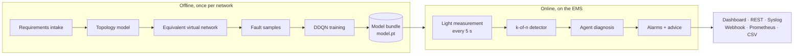
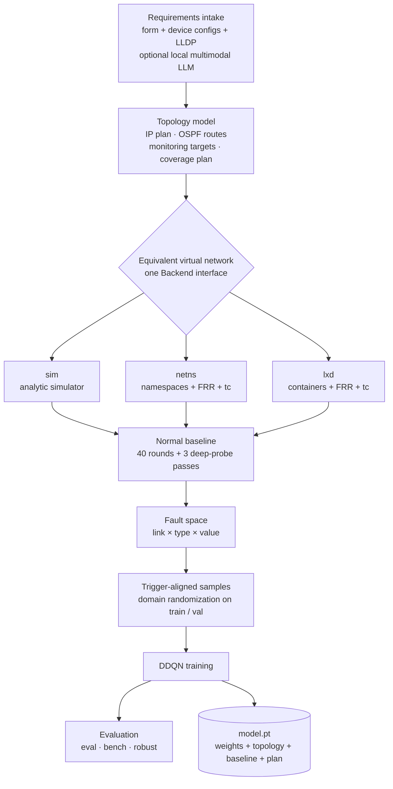
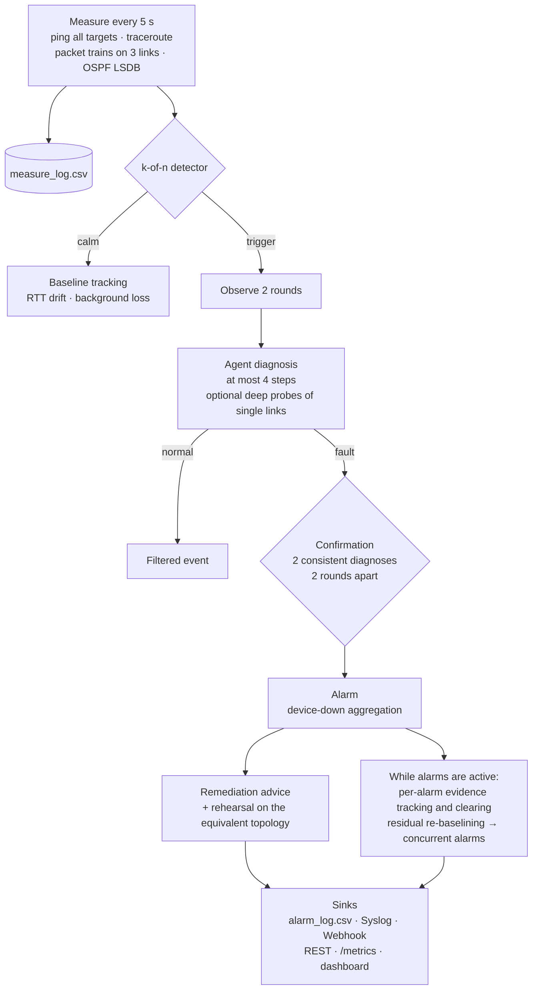

# Architecture

EdgeFDL runs on the network-management server of an edge network (the "EMS") and turns light periodic
measurements into one alarm per fault, naming the faulty link and the fault type. The system has two halves:
an **offline pipeline** that builds a per-network model from an equivalent virtual network, and an **online
loop** that measures the network every 5 s and diagnoses it with that model.

This page describes the components, how data flows between them and which files they exchange. The methods
themselves (features, detector, agent, baselines, multi-fault logic) are specified in
[algorithms.md](algorithms.md); the HTTP interface is in [api.md](api.md); deployment steps are in
[deployment.md](deployment.md).

- [System overview](#system-overview)
- [Offline pipeline](#offline-pipeline)
- [Online loop](#online-loop)
- [Module map](#module-map)
- [Data artefacts](#data-artefacts)
- [Design principles](#design-principles)

## System overview

- **Single vantage point.** Connectivity, delay, loss and path probes start at the EMS; links that no EMS probe
  crosses are covered by device-native NQA / IP SLA probes. EdgeFDL never writes device configuration; packet-train
  bandwidth estimates and deep probes run between the two ends of a link, using the probe endpoints that the topology
  marks ([algorithms.md](algorithms.md#21-measurement-plan)).
- **One model per network.** The model is trained on faults injected into an equivalent virtual network built
  from the network's own topology; no production fault data is needed.
- **One file to deploy.** The model bundle carries the weights together with the topology, the normal
  baseline and the measurement plan it was trained with.

## Offline pipeline

| Stage | What happens | Code | Output |
|---|---|---|---|
| Requirements intake | A YAML form lists devices, roles, sites and the EMS; interfaces, addresses, OSPF costs and speeds are extracted from Huawei VRP, H3C Comware or Cisco IOS configuration text and LLDP tables; missing interface names, point-to-point addresses and loopbacks are planned automatically. Topology images or PDFs can optionally be read by a locally hosted OpenAI-compatible multimodal model. | `intake/form.py`, `intake/extract.py`, `topology.py` | topology YAML |
| Topology model | Devices, links (bandwidth, one-way delay, jitter, loss, OSPF cost), deterministic OSPF shortest paths, the monitoring targets and the coverage plan (blind links get a device-native NQA / IP SLA probe target). | `topology.py` | `Topology` object |
| Equivalent virtual network | Three interchangeable backends with the same interface and fault semantics: `sim` (analytic, millisecond samples), `netns` (Linux network namespaces, veth pairs, FRR OSPF, tc), `lxd` (one LXD container per device, one bridge per link, optional bridge to a physical port). | `vnet/` | measurements |
| Normal baseline | Per-target RTT, RTT deviation, background loss and traceroute path; per-link bandwidth estimate and OSPF cost; per-link deep-probe RTT, deviation and capacity. | `faults/generator.py` (`learn_baseline`), `agent/features.py` (`Baseline`) | `baseline.json` |
| Fault space | Every link × fault type × value: link down, delay, loss, jitter, bandwidth degradation, route drift (231 fault primitives on the demo topology). | `faults/model.py`, `faults/generator.py` | list of `Fault` |
| Samples | Each sample is cut at the moment the online detector would wake the agent; training and validation sets add domain randomization; the independent test set uses standard conditions. | `faults/generator.py` | `*.npz` + `*_samples.csv` |
| Training | Double DQN with dueling heads, a link-shared encoder, prioritized replay and action masking; the agent may request deep probes at a cost. | `agent/ddqn.py` | `model.pt` |
| Evaluation | End-to-end accuracy on the test sets, self-test (latency, long noise run, overhead, online scenarios), robustness suite. | `agent/ddqn.py` (`evaluate`), `bench.py`, `robust.py` | `eval_test.json`, `bench.json`, `robust.json` |

`python -m edgefdl pipeline` runs baseline → samples → training → evaluation → self-test in one command on the
`sim` backend (see [quickstart.md](quickstart.md)). The released outputs of that command are in
[`results/`](../results/README.md).

## Online loop

Every round (`Engine.step` in [`core/orchestrator.py`](../edgefdl/core/orchestrator.py)):

1. **Measure.** The backend returns one `RoundResult`: per-target ping statistics with the traceroute path,
   bandwidth estimates for the links polled this round, and the OSPF adjacency state and cost of every link.
   The round is appended to `measure_log.csv` before anything else happens.
2. **Detect.** The k-of-n detector marks each target and link as anomalous or not for this round and decides
   whether the network has just become anomalous (*trigger*), stays anomalous (*active*) or has *recovered*.
   A single-round spike on its own does not trigger it.
3. **Adapt.** While no confirmation is pending, the RTT baseline follows slow drift; background loss is
   relearned under the conditions given in [algorithms.md](algorithms.md#10-adaptive-baseline).
4. **Diagnose.** Two rounds after a trigger, and then every 6 rounds while the detector stays active (every
   2 rounds while a conclusion awaits confirmation), the agent diagnoses the last 6 rounds. It answers "normal",
   or a fault type on a link, after at most 4 steps; up to 3 of these steps may be deep probes of single links.
5. **Confirm and alarm.** A fault conclusion becomes an alarm after two consistent diagnoses at least 2 rounds
   apart. A link-down conclusion whose endpoint device has lost all its router adjacencies and whose loopback is
   unreachable becomes one device-down alarm. Each alarm carries evidence, candidate conclusions, deep-probe
   results, vendor-specific commands and the result of rehearsing the remediation on the equivalent topology.
6. **Concurrent faults and clearing.** Four rounds after the set of alarms changes, the engine freezes a
   residual baseline that explains the alarmed faults; the agent then diagnoses the residual with the alarmed
   links masked, and a second fault raises its own alarm after three consistent confirmations. Each alarm
   clears on the evidence of its own link. `--single-alarm` restores the one-alarm-at-a-time behaviour.

With the default parameters, a persistent fault is alarmed in the 6th measurement round after it starts when
the control plane changes (2 rounds to trigger, 2 to observe, 2 to confirm) and in the 7th round for
data-plane-only faults (3 + 2 + 2); measured times to alarm are in [results.md](results.md).

**Threads.** The measurement loop runs in one thread. The HTTP server (standard library
`ThreadingHTTPServer`) reads thread-safe snapshots under the engine lock. Deep probes, including the at most one
recheck probe per round used for clearing alarms, run outside the lock. Webhook delivery runs in a background
thread; Syslog is a non-blocking UDP send.

**Integrations.** The dashboard (`/`), REST endpoints (`/api/*`), Prometheus metrics (`/metrics`), CSV export,
Syslog (RFC 5424 over UDP) and Webhook (JSON POST) are described in [api.md](api.md). Demo fault injection
(`POST /api/inject`, `/api/clear`) is accepted only on the virtual backends and can be disabled with
`serve --no-inject`.

## Module map

| Module | Responsibility |
|---|---|
| [`edgefdl/__init__.py`](../edgefdl/__init__.py), [`__main__.py`](../edgefdl/__main__.py) | Package version (`0.1.0`) and the `python -m edgefdl` entry point. |
| [`edgefdl/cli.py`](../edgefdl/cli.py) | Command line: `topo`, `intake`, `baseline`, `gen`, `train`, `eval`, `bench`, `robust`, `serve`, `vnet`, `pipeline`; loads a model bundle and assembles the online engine. |
| [`edgefdl/topology.py`](../edgefdl/topology.py) | Topology data model (`Node`, `Link`, `Target`), automatic /30 and loopback planning, deterministic OSPF shortest paths, forward and return route of every target, monitoring targets and coverage planning. |
| [`edgefdl/intake/form.py`](../edgefdl/intake/form.py) | Requirements form (YAML) plus device configurations and LLDP → topology; form template. |
| [`edgefdl/intake/extract.py`](../edgefdl/intake/extract.py) | Parses Huawei VRP, H3C Comware and Cisco IOS configuration text (hostname, interfaces, addresses, OSPF cost, speed), pairs interfaces into links by shared subnet, reads LLDP CSV, optional extraction from images/PDF via an OpenAI-compatible multimodal endpoint. |
| [`edgefdl/vnet/base.py`](../edgefdl/vnet/base.py) | `Backend` interface (`up`, `down`, `inject`, `clear`, `measure_round`, `deep_probe`, `status`) and the backend factory. |
| [`edgefdl/vnet/sim.py`](../edgefdl/vnet/sim.py) | Analytic simulator: OSPF routes, per-packet random delay, jitter and loss, packet-train estimates with multiplicative noise, LSDB view, transient interference, optional ICMP rate limiting. |
| [`edgefdl/vnet/stack.py`](../edgefdl/vnet/stack.py) | Shared real-kernel backend for `netns` and `lxd`: L3 configuration, FRR or static routing, fault commands, concurrent ping / traceroute / packet-train / LSDB measurement rounds, deep probes, convergence wait, LSDB parsing. |
| [`edgefdl/vnet/netns.py`](../edgefdl/vnet/netns.py) | Linux network-namespace backend: one namespace per device, one veth pair per link, one FRR instance per router. |
| [`edgefdl/vnet/lxd.py`](../edgefdl/vnet/lxd.py) | LXD backend: one container per device, one bridge per link, optional macvlan / bridged uplink to a physical port; `python -m edgefdl.vnet.lxd` prints the full command sequence (dry run). |
| [`edgefdl/vnet/frr.py`](../edgefdl/vnet/frr.py) | FRR configuration generator: single-area OSPF, point-to-point router links, hello 1 s / dead 4 s, host-facing interfaces and loopbacks passive. |
| [`edgefdl/faults/model.py`](../edgefdl/faults/model.py) | Fault types, value ranges, labels, alarm categories and fault-space enumeration. |
| [`edgefdl/faults/injector.py`](../edgefdl/faults/injector.py) | Translates a fault into apply / revert commands (`tc` netem + tbf, `ip link` / `ip addr`, `vtysh` OSPF cost); also the baseline queue configuration. |
| [`edgefdl/faults/generator.py`](../edgefdl/faults/generator.py) | Baseline learning, fault-space filtering, trigger-aligned sample generation with domain randomization, multi-process generation, dataset writer. |
| [`edgefdl/measure/model.py`](../edgefdl/measure/model.py) | Measurement records (`PingStat`, `LsdbEntry`, `RoundResult`, `DeepProbe`) and the `MeasurePlan` with its traffic budget. |
| [`edgefdl/measure/probes.py`](../edgefdl/measure/probes.py) | Command builders and output parsers for ping, traceroute, iperf3 and packet trains; packet-train capacity estimator. |
| [`edgefdl/measure/store.py`](../edgefdl/measure/store.py) | Measurement and alarm CSV logs with `schema_version` and `*.schema.json`, line flush, periodic fsync, size-based rotation. |
| [`edgefdl/agent/features.py`](../edgefdl/agent/features.py) | `Baseline`, `FeatureEncoder` (21 light, 6 deep and 8 global features), per-round anomaly test, direct-evidence checks, residual baseline (`ResidualRef`), per-alarm round evidence, RTT baseline tracking. |
| [`edgefdl/agent/ddqn.py`](../edgefdl/agent/ddqn.py) | Q-network, dataset loader, action masks, reward, Double DQN + PER training, rollout, end-to-end evaluation, bundle save / load. |
| [`edgefdl/agent/infer.py`](../edgefdl/agent/infer.py) | Online `Policy`: at most 4 forward passes per diagnosis, on-demand deep probes, link masking, direct-evidence gate, evidence text, latency statistics; NumPy inference engine. |
| [`edgefdl/agent/knowledge.py`](../edgefdl/agent/knowledge.py) | Vendor command templates (Huawei VRP, H3C Comware, Linux/FRR) and rehearsal of remediation on the equivalent topology, for link faults and device-down. |
| [`edgefdl/core/denoise.py`](../edgefdl/core/denoise.py) | k-of-n detector with hysteresis, shared by sample generation and the online engine. |
| [`edgefdl/core/orchestrator.py`](../edgefdl/core/orchestrator.py) | `Engine`: measurement loop, diagnosis scheduling, confirmation, alarms (concurrent or single), device-down aggregation, per-alarm clearing, baseline adaptation, snapshots. |
| [`edgefdl/core/alarms.py`](../edgefdl/core/alarms.py) | Severity mapping and the Syslog (RFC 5424) and Webhook sinks. |
| [`edgefdl/core/api.py`](../edgefdl/core/api.py) | HTTP server (standard library only): dashboard, REST endpoints, Prometheus metrics, CSV export, demo fault injection. |
| [`edgefdl/core/web/index.html`](../edgefdl/core/web/index.html) | Single-page operations dashboard (Chinese UI). |
| [`edgefdl/bench.py`](../edgefdl/bench.py) | Self-test: inference latency, long run under transient noise, measurement and compute overhead, online fault scenarios. |
| [`edgefdl/robust.py`](../edgefdl/robust.py) | Robustness suite: harsher interference, missing measurements, ICMP rate limiting, background jitter, busy-hour drift, fault-size sweep, concurrent link faults and device-down cases. |
| [`edgefdl/report.py`](../edgefdl/report.py) | Evaluation result → Markdown table. |

Outside the package: [`scripts/lab.sh`](../scripts/lab.sh) and [`scripts/lab/Dockerfile`](../scripts/lab/Dockerfile)
build a privileged Debian 12 container with FRR, iperf3, traceroute and iproute2;
[`scripts/netns_smoke.py`](../scripts/netns_smoke.py) runs the real-protocol-stack smoke test in it;
[`scripts/compare_robust.py`](../scripts/compare_robust.py) compares multi-alarm and single-alarm robustness
runs seed by seed; [`tests/test_core.py`](../tests/test_core.py) holds the unit tests;
[`tools/dev/spdx.py`](../tools/dev/spdx.py) checks license headers; [`configs/`](../configs/) holds the demo
topology and a sample intake form with device configurations.

## Data artefacts

### Topology file

The topology YAML ([`configs/demo_topology.yaml`](../configs/demo_topology.yaml)) is the single description of
the network. It lists `nodes` (`name`, `role` = router | switch | host | ems, `vendor`, `model`, `loopback`,
`agent`, `site`), `links` (`id`, `a`, `b`, interface names, addresses, `bw` in Mbit/s, one-way `delay` and
`jitter` in ms, `loss`, OSPF `cost`), the `vantage` (the EMS) and optional `ip_plan` pools. Empty interface
names, /30 link addresses and router loopbacks are filled in automatically; `python -m edgefdl topo -o out.yaml`
writes the completed plan.

The demo topology has 12 devices (core, agg1, agg2, acc1–acc4 routers, hosts h1–h4, the EMS) and 15 links L1–L15
at 1000 or 100 Mbit/s, with a mix of Huawei and H3C devices.

### Model bundle (`model.pt`)

A single `torch.save` file, written by `train` and read by `serve`, `eval`, `bench` and `robust`:

| Key | Content |
|---|---|
| `state` | Q-network weights (36,041 parameters for the demo topology) |
| `cfg` | `AgentConfig` used for training (hidden size, steps, reward, optimizer, replay) |
| `dims` | feature sizes and link count `[21, 6, 8, L]` |
| `drift_links` | indices of links on which route drift is a valid action |
| `meta.version`, `meta.created` | model version string and creation time |
| `meta.topology` | the complete topology, including planned interfaces and addresses |
| `meta.baseline` | the normal baseline (per-target RTT, deviation, background loss and path; per-link bandwidth, cost and deep-probe baseline) |
| `meta.plan` | the `MeasurePlan` the samples were generated with |
| `meta.train`, `meta.val` | training history and validation-set evaluation |

Deploying a model therefore needs only this file: `serve --model model.pt` rebuilds the topology, the feature
encoder, the detector and the measurement plan from it. `serve --learn-rounds N` replaces the bundled baseline
with one learned on site. The bundle is a PyTorch pickle; load bundles only from sources you trust.

### Sample sets (`*.npz` + manifest)

`gen` and `pipeline` write one compressed NumPy archive per set, plus a CSV manifest next to it
(`train.npz` → `train_samples.csv`):

| Array | Shape | Meaning |
|---|---|---|
| `light` | (N, L, 21) | light features of each link over the 6-round window |
| `glob` | (N, 8) | global features |
| `deep` | (N, L, 6) | deep-probe features of every link (revealed to the agent only when it probes) |
| `y_type`, `y_link`, `y_value` | (N,) | fault type index (6 = normal), link index (−1 = none), fault value |
| `noisy` | (N,) | a transient was present in the window |
| `detected`, `det_rounds` | (N,) | whether the detector woke the agent, and after how many rounds |
| `link_ids`, `is_host`, `drift_links` | (L,), (L,), (·) | link order, host-link flags, links allowing route drift |

The manifest has one row per sample with `sample_id`, `fault_type`, `fault_link`, `fault_value`,
`transient_noise`, `detected` and `detect_rounds`, so every sample can be traced back to the injected fault.
`gen --raw-csv` (single-process generation) also writes every measurement round in the measurement-log format,
tagged with `sample_id` and `fault_label`.

### Logs

The online engine writes two CSV logs into `--log-dir` (default `runs/live`):

| File | Rows | Columns (abridged) |
|---|---|---|
| `measure_log.csv` | one per target ping, bandwidth estimate, LSDB entry and deep probe (`kind` = ping, bw, lsdb, deep) | `ts`, `epoch`, `round_id`, `vantage`, `target_id`, `target_ip`, `target_node`, `link_id`, `sent`, `recv`, `loss`, `rtt_min/avg/max/mdev_ms`, `bw_mbps`, `path`, `adj_up`, `cost`, `probe_bytes` |
| `alarm_log.csv` | one per alarm `raise` and `clear` | `alarm_id`, `ts`, `event`, `severity`, `category`, `fault_type`, `fault_type_cn`, `link_id`, `endpoints`, `site`, `confidence`, `evidence` (JSON), `repair`, `probes_used`, `infer_ms`, `round_id`, `model` |

Each row carries `schema_version` (currently `1.0`), and each log has a `*.schema.json` file with the column
names and descriptions, so other systems can parse the logs without reading the code. Rows are flushed line by
line; the measurement log is fsynced every 5 s and the alarm log on every write; files rotate at 200 MB and the
20 most recent archives are kept. `fault_type` is a stable code (`link_down`, `delay`, `loss`, `jitter`,
`bandwidth`, `route_drift`, `node_down`); `fault_type_cn`, `category`, the evidence text and the schema
descriptions are Chinese display strings.

### Released results

[`results/`](../results/README.md) holds the released model bundle, its baseline, the evaluation, self-test and
robustness JSON files, the pipeline log and the real-stack smoke logs; [results.md](results.md) explains them.

## Design principles

**Single source of truth: the topology.** The same `Topology` object builds the virtual network and its FRR
configuration, translates faults into commands, generates the monitoring targets and the coverage plan,
provides the routing matrices that the features use, drives the remediation rehearsal and lays out the
dashboard. Any two components that talk about "link L6" or "the path to acc3" agree by construction.

**Interchangeable backends.** `sim`, `netns` and `lxd` implement one interface and return identical
`RoundResult` / `DeepProbe` records. Fault semantics match: the simulator's per-direction delay, normal-
distributed jitter, loss and rate limit mirror the `tc` netem + tbf configuration that the real backends apply,
and link down withdraws the subnet in both. The fast simulator produces the full training set; the real stacks
validate the semantics and can generate samples for calibration.

**Training–deployment symmetry.** Sample generation uses the online detector, the same feature encoder and the
same measurement plan, and cuts each sample at the round in which the online engine would call the agent.
The bundle carries the plan and baseline, so the deployed engine sees inputs drawn from the distribution the
agent was trained on.

**Fail-safe loop.** Every round is wrapped in an exception handler that counts and logs errors and continues;
HTTP handler errors return an error response without touching the loop; sinks never block it; logs are flushed
per line. Inference is single-threaded with a keep-alive forward pass every round, so diagnosis latency stays
predictable. In the 72-hour-equivalent self-test (51,840 simulated rounds with transient noise) the engine
recorded 0 errors (see [results.md](results.md)).

**Read-only towards devices.** On a production network EdgeFDL only sends probes and reads state. Fault
injection exists for the virtual backends and is refused by the API on any other backend. Remediation is
advisory: the alarm lists vendor-specific commands and the rehearsed effect of a temporary measure, and an
operator decides whether to apply it.
